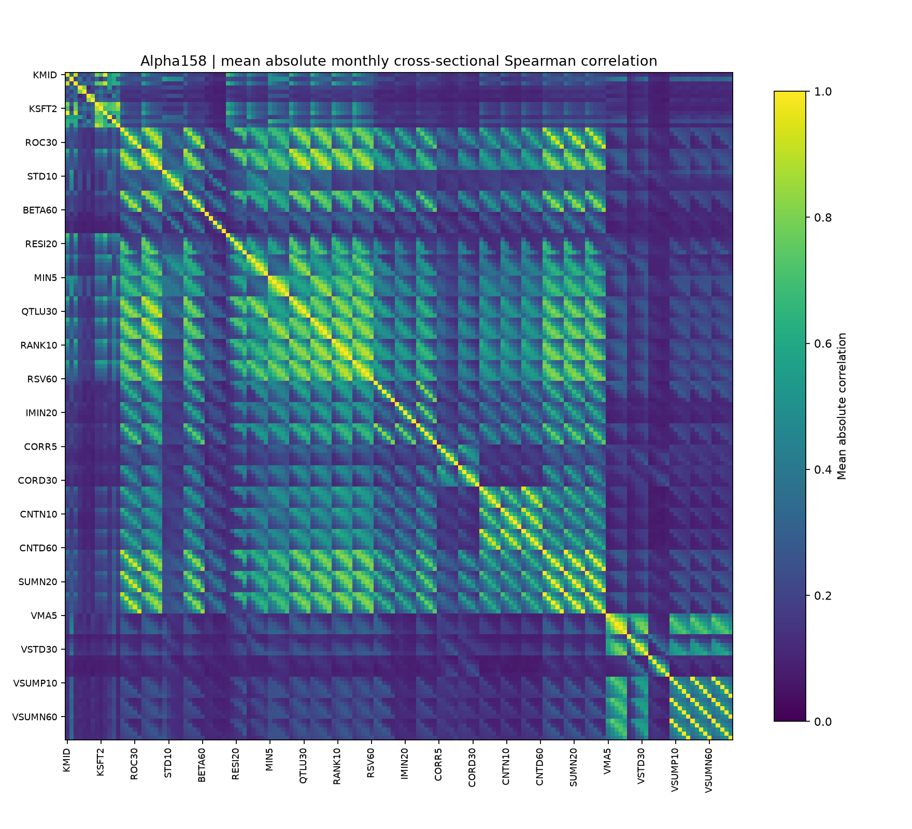

# 沪深300指数增强策略-基于Alpha158和LightGBM

基于 **Microsoft Qlib、Alpha158量价特征与LightGBM** 的A股多因子指数增强研究。项目覆盖历史股票池与复权数据处理、五日市场残差收益预测、组合构建、交易执行模拟，以及因子有效性、风险暴露、成本和容量分析。

核心流程：**历史沪深300成员 → Alpha158特征 → 五日残差收益目标 → LightGBM排序 → Top50换股 → 扣费及滑点后的账户评价**。

2016—2025开发回测中，加入每边3bp成交价滑点后，策略的**平均年度超额IR为1.378，年化收益16.66%，最大绝对回撤−29.47%**。以下同时展示无滑点基线、同规则线性参考及统计诊断，区分预测能力、组合表现与执行成本。

## 回测结果与模型对照

区间统一为2016-01-04至2025-12-31，共2,430个交易日；连续初始资金1亿元，基准为**H00300沪深300全收益指数**。账户与基准均从首个建仓日收盘投入，账户首日交易费用计入净值。

| 模型与执行情形 | 平均年度超额IR | 全期超额IR | 十年年化收益 | 最大绝对回撤 | 最大相对回撤 |
| --- | ---: | ---: | ---: | ---: | ---: |
| LightGBM，基础费用、无滑点 | 1.532 | 1.489 | 18.01% | −30.50% | −10.62% |
| **LightGBM，每边3bp成交价滑点** | **1.378** | **1.344** | **16.66%** | **−29.47%** | **−9.58%** |
| 固定Ridge参考，每边3bp成交价滑点 | 0.429 | 0.486 | 9.36% | −43.15% | −16.74% |


超额IR以日净策略收益减日基准收益计算：`mean(日净超额收益) / std(日净超额收益, ddof=1) × sqrt(252)`。**平均年度IR**先对十个年度分别计算再取算术平均，**全期IR**直接使用全期日收益；二者分别报告。年化收益按十个日历年的复利计算。

Ridge与LightGBM使用相同的158项特征、标签、训练/验证样本、应用时间段及交易规则。Ridge的缺失填补、标准化仅拟合训练段，标准化值截断至±5，平均平方误差目标下的正则系数固定为1，截距不惩罚。LightGBM保留原输入处理流程。对照结果支持当前LightGBM建模流程，但不能将全部差异单独归因于非线性。

## 数据、特征与预测目标

### 数据与信息时点

- **股票池**：按历史沪深300成分区间逐日取成员，避免以当前成员回填历史。
- **行情**：Qlib复权价格与复权单位，原始缓存版本为chenditc/investment_data的2026-10-20版本；该版本不等于每个历史时点的数据供应商原始快照。
- **单位与缺失**：成交额源单位为千元，成交量为复权百股单位；缺失行情与不可交易状态在各环节显式处理。
- **信息时序**：t收盘后计算特征、预测和换股计划，t+1模拟收盘成交。未来价格仅进入已成熟训练标签和事后评价。

### Alpha158与五日市场残差目标

Alpha158由9项K线特征、4项当期价格比例，以及29类滚动特征×5个窗口组成，覆盖价格形态、趋势、波动、量价关系与成交量结构。[158项表达式字典](docs/alpha158_dictionary.csv)保留具体计算公式。

学习目标为t+1收盘至t+6收盘的股票收益，扣除历史beta对应的市场收益：

```text
y_raw(i,t) = close(i,t+6)/close(i,t+1) − 1
             − beta(i,t) × [market(t+6)/market(t+1) − 1]
```

market使用SH000300价格指数。beta仅使用截至t的252日历史配对收益，指数半衰期60日，至少126对有效观测，不足时回退为1、不截断。原始目标再做当日横截面标准化。训练和验证按标签退出日截断；推理特征没有全样本标准化。

减去市场分量旨在学习股票相对表现，实际组合仍是股票多头。训练目标中的价格指数与账户评价中的全收益指数分别定义。模型分数用于排序，不直接解释为预期收益率；五日预测目标也不等于固定持仓五日。

### 模型时间切分

| 模型应用期 | 训练年份 | 验证年份 | LightGBM树数 |
| --- | --- | --- | ---: |
| 2016 | 2008—2013 | 2014—2015 | 11 |
| 2017以后 | 2008—2014 | 2015—2016 | 20 |

两个模型训练后保持冻结。参考实验逐段核对训练样本索引与特征值指纹，记录标签成熟截止日与验证误差，见[训练记录](results/research/linear_reference/training.json)。

## 因子有效性与特征冗余

诊断覆盖728,716行特征；五日标签成熟的信号日为2016-01-04至2025-12-23，共2,424天，标签退出价格不超过2025-12-31。账户交易日与成熟标签日的数量不同。

逐日横截面计算Pearson IC、RankIC、非年化ICIR、有效覆盖率，并保留分年结果及分组前瞻均值。缺失值先成对删除，再分别对特征与目标排名，至少30对有效样本才计算当日IC。

| 特征或预测分数 | 平均RankIC | 观察 |
| --- | ---: | --- |
| LightGBM预测分数 | 0.0583 | 整体排序关联为正 |
| 固定Ridge预测分数 | 0.0514 | 排序关联为正，扣费组合表现弱于LightGBM |
| CORR20 | −0.0371 | 量价相关特征呈负向关联，BY校正后q约0.0026 |
| KMID | −0.0043 | 未通过该检验族的BY校正 |
| KUP2 | −0.0014 | 未通过该检验族的BY校正 |


累积RankIC用于展示预测关联的变化；分组图展示重叠五日标签的日组均值。**这两类图均不是可交易净值，不能将重叠前瞻收益直接连乘。** 负IC保留原始符号，没有根据全期结果翻转方向再构造策略。

按120个月各自最后一个成熟信号日计算横截面Spearman相关，分别平均带符号相关与绝对相关。VSUMP、VSUMN、VSUMD等方向占比特征存在近乎相同或相反的排序，表明158项表达式包含冗余信息。相关矩阵用于诊断，最终模型未据此重新筛选或训练。



完整结果：[因子统计](results/research/report/factor_statistics.csv) · [逐年RankIC](results/research/report/annual_mean_rank_ic.csv) · [特征相关对](results/research/report/correlation_pairs.csv)。

## 统计稳健性与过拟合诊断

采用**20日固定圆形连续块Bootstrap**，重复19,999次、随机种子20261027，保留块内相邻日期关系。对158项原始特征的平均RankIC进行双侧检验，再做Benjamini–Yekutieli（BY/BHY）多重检验校正；5%阈值下32项拒绝平均RankIC为零的原假设。

| 统计量 | 点估计 | 分块Bootstrap描述性95%区间 |
| --- | ---: | ---: |
| LightGBM 3bp，全期超额IR | 1.344 | [0.780, 1.925] |
| LightGBM减Ridge，同3bp全期超额IR差值 | 0.858 | [0.420, 1.299] |
| LightGBM减Ridge，平均RankIC差值 | 0.00692 | [0.00036, 0.01359] |

两个模型的差值使用同一次抽样同步重抽日期。IR区间对应全期IR，不对应平均年度IR。BY检验仅覆盖当前158项，依赖近似p值的有效性；不能校正此前所有策略尝试，也不代表发现32个独立可盈利策略。

2016—2025已反复用于策略开发，因此上述结果属于开发期证据。分块抽样和多重检验有助于表达统计不确定性，不能替代后续独立时间段验证。[统计参数](research_config.json)与[配对差值结果](results/research/report/paired_model_differences.csv)均随仓库保存。

## 组合构建、交易成本与滑点

策略持有约50只股票，每日通常最多替换5只；新买入批次预算近似均分，买入预算系数为95%。组合不会每日恢复等权，价格变化会造成权重漂移，95%的买入批次预算也不等于总股票仓位95%。

交易模拟保留整手、T+1与最短持有期、现金、停牌/方向限制、一字价格检查，以及日成交量和成交额各5%的容量约束。原设置没有行业中性、硬性单股2%上限或跟踪误差优化约束。

每边3bp场景直接改变执行价格：

| 环节 | 设置 |
| --- | --- |
| 买入价格 | 次日复权收盘价×1.0003 |
| 卖出价格 | 次日复权收盘价×0.9997 |
| 基础费用 | 买入0.05%、卖出0.15%，每笔最低5元；按滑后实际成交金额计算 |
| 日终估值 | 原复权收盘价；滑点已进入成交盈亏，不重复收取滑点费用 |
| 价格可行性 | 滑后价格越过当日高低价则拒单 |
| 容量 | 实际成交量和成交额均检查5%日上限 |

滑点实验重新模拟完整账户；价格变化、拒单、现金和持仓差异进入后续交易。因此与无滑点基线的差异同时包含执行价格和交易路径变化，不能仅当作额外费用相减。固定日线滑点仍是简化执行模型，未重放盘口或收盘竞价，也未按订单规模估计动态冲击。[成交价滑点实验](results/slippage_3bp/README.md)保留订单与核查记录。

## 风险暴露、换手与容量

使用前一日持仓及当时可知的数据，分析历史beta、60日波动、252−21日动量和20日平均成交额对数。后三项参考当日等权沪深300横截面z分数；覆盖不足98%的日暴露留空，并单独记录覆盖率。


| 执行诊断 | LightGBM每边3bp场景 |
| --- | ---: |
| 平均股票敞口 | 99.31% |
| 年均双边换手：买卖额之和/前净值 | 44.86倍 |
| 年均基础费用日占比加总 | 4.48% |
| 年均成交价滑点损失日占比加总 | 1.35% |
| 单市场描述性回归的组合beta | 约1.061 |

费用和滑点占比是按每日前净值归一的归因加总，不能直接从CAGR扣减。风险代理尚未覆盖完整历史行业、市值、基本面及指数权重，当前分析不构成完整Barra归因或相对真实指数权重的风格中性检验；单市场回归截距也不解释为纯选股Alpha。

将已成交路径的金额和数量静态放大，检查5%日容量限制：

| 成交路径倍数 | 对应初始资金 | 超限股票日的成交金额占比 |
| --- | ---: | ---: |
| 0.5倍 | 0.5亿元 | 0.00% |
| 1倍 | 1亿元 | 0.00% |
| 2倍 | 2亿元 | 15.86% |
| 5倍 | 5亿元 | 47.48% |

这是对已经成交路径的压力测试，没有重算规模变化后的现金、拒单、持仓与冲击，不能据此确定实盘容量上限。[容量表](results/research/report/static_capacity_stress.csv)与[年度执行统计](results/research/report/annual_execution.csv)保留具体口径。

研究另按前一日200日均线位置和60日年化波动25%阈值描述条件表现，未据此修改仓位。分组样本长度不等、日期不连续，条件IR不等于可单独交易的子策略净值，见[市场状态分析](results/research/report/conditional_regimes.csv)。

## 与沪深300增强基金对照

选取五只具有完整十年公开净值的存续基金示例，统一2016—2025区间、首日收盘投入和H00300全收益基准。基金按单位净值与现金分红重建分红再投资收益。

| 样本 | 平均年度超额IR | 全期超额IR | 十年年化收益 | 最大回撤 | 跟踪误差 |
| --- | ---: | ---: | ---: | ---: | ---: |
| **LightGBM，含每边3bp滑点** | **1.378** | **1.344** | **16.66%** | **−29.47%** | **8.30%** |
| LightGBM，无滑点基线 | 1.532 | 1.489 | 18.01% | −30.50% | 8.30% |
| 富国沪深300增强A/B（100038） | 0.397 | 0.323 | 6.52% | −39.02% | 2.96% |
| 景顺长城沪深300增强A（000311） | 0.104 | 0.125 | 5.88% | −43.24% | 3.17% |
| 易方达沪深300量化增强A（110030） | 0.134 | 0.127 | 5.84% | −45.62% | 3.33% |
| 兴全沪深300增强LOF A（163407） | 0.632 | 0.453 | 7.67% | −36.26% | 4.53% |
| 华夏沪深300增强A（001015） | 0.481 | 0.537 | 6.90% | −38.43% | 2.75% |

模型主动波动约8.30%，高于这组基金的2.75%—4.53%。基金为真实公布净值并包含运营费用；模型为开发回测，仅包含声明交易成本。投资约束、规模、集中度与费用不同，五个存续示例也不代表全市场排名。

净值及逐年对照图见[基金对照报告](results/peers/README.md)：其中模型曲线沿用无滑点基线；上表含滑点模型行取自独立滑点账户，基金与基准口径不变。数据出处见[基金数据说明](data/peers/README.md)。

## 复现与验证

推荐Python 3.12，在仓库根目录运行：

```bash
python -m venv .venv
# Windows: .venv\Scripts\activate
# macOS/Linux: source .venv/bin/activate
python -m pip install -r requirements.txt
python run.py check
python -m unittest discover -s tests
```

无需原始股票行情，可从保存输入重算研究表格、图表和账户报表：

```bash
python run.py research-report --output runs/research-report
python run.py slippage-report --output runs/slippage-report
python run.py report --output runs/base-report
python run.py peers --output runs/peers
```

准备Qlib行情后，可重新生成逐日成交与账户：

```bash
python run.py slippage --data-dir /path/to/qlib_data --output runs/slippage3bp
python run.py backtest --data-dir /path/to/qlib_data --output runs/base-replay
python run.py research-backtest --data-dir /path/to/qlib_data --output runs/ridge-3bp
python run.py predict --data-dir /path/to/qlib_data --start 2025-12-29 --end 2025-12-31 --output runs/predictions.parquet
```

输入格式、字段单位见[data/README.md](data/README.md)。仓库不分发大型原始行情与特征缓存；报告复算、成交重放和完整重建训练数据的依赖范围分别说明，新输出不覆盖旧文件。

已记录的核查包括17项测试、800条原保存残差标签与独立实现交叉核对，以及成交价、费用、日现金、容量与信号领先一日核对。发布下载版的表格和五张研究图复算一致，见[验证记录](results/research/release_checks.json)及[数据指纹](results/research/source_provenance.json)。这些检查验证声明实现与复算一致性，不替代独立样本外或真实实盘验证。

## 研究边界与后续方向

当前使用Qlib复权价格/复权单位账户，不单独模拟现金分红到账、送转登记或新增股份解锁，也不再额外计入一次分红现金；factor参与交易单位换算。复权尺度、实际现金股份账簿与真实执行的差异需结合应用场景评估。

后续研究方向包括训练段相关性压缩、成本敏感换股、集中度控制，以及补齐历史行业和基准权重后的主动风险优化。现有版本保留固定模型与规则，未利用上述开发期诊断继续调参；尚未接入另类数据或部署实盘。

## 项目文档与结构

- [项目介绍](docs/项目介绍.md)：架构、研究模块与能力范围。
- [研究流程与证据](docs/研究流程与证据.md)：数据时点、因子、模型、统计和风险分析原理。
- [研究诊断明细](results/research/README.md)：逐日统计、固定Ridge、风险和执行结果。
- [来源说明](NOTICE.md)：Qlib、LightGBM、研究参考与数据出处。

```text
run.py                       检查、预测、回测及研究报告入口
config.json                  固定交易与评价设置
research_config.json         研究诊断与固定线性参考设置
models/                      两个冻结LightGBM模型
src/model.py                 Alpha158与冻结模型推理
src/orders.py                前日信息形成换股计划
src/exchange.py               费用、现金、容量与价格检查
src/slippage_exchange.py      不利成交价滑点
src/backtest.py               Qlib复权价格账户
src/metrics.py                超额IR、净值、回撤与绘图
src/linear_reference.py       固定Ridge训练与预测
src/research_*.py             因子统计、Bootstrap/BY及研究报告
src/peers.py                  基金分红再投资与产品对照
data/                        固定预测、基准与基金净值
results/                     原账户、滑点、产品及研究诊断结果
docs/                        项目介绍、研究方法与表达式字典
tests/                       指标、交易与研究统计测试
```
