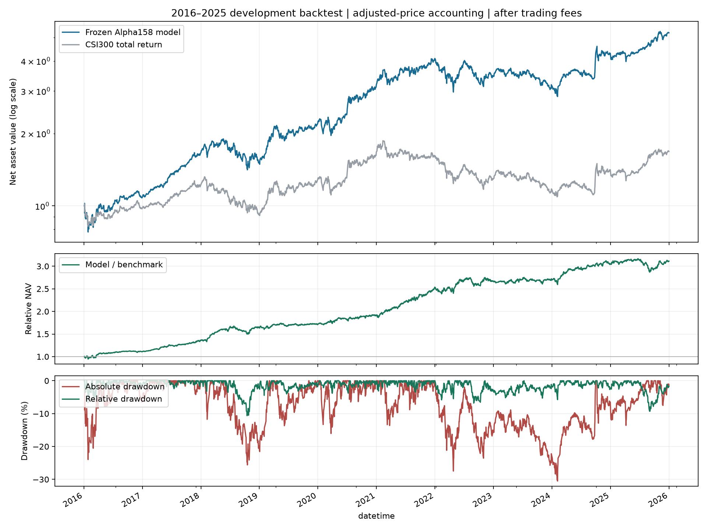
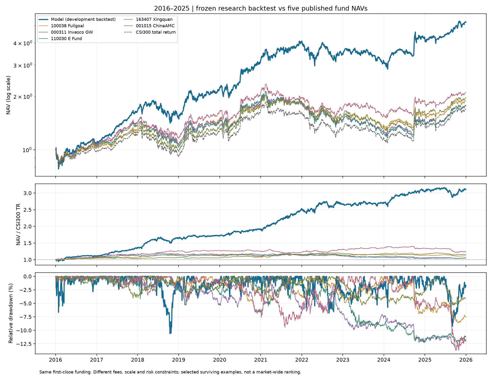
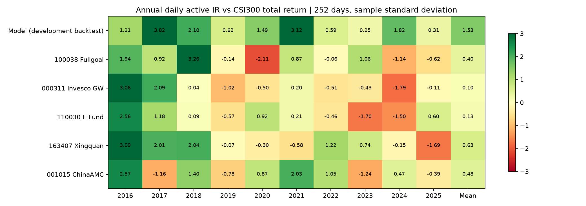

# 沪深300指数增强：Alpha158 + LightGBM

项目框架：**量价特征 → 相对收益预测 → Top50换股 → 扣费后指数增强回测**。

## 模型与策略

- **股票池**：按历史沪深300成分区间逐日取成员。
- **输入**：Qlib Alpha158的158项量价特征，无推理阶段全样本标准化。
- **学习目标**：t+1收盘到t+6收盘的五日股票收益，减去截至t估计的市场β乘以同段市场收益，再做当日横截面标准化。β使用过去252日、半衰期60日，至少126对有效观测，不足时回退为1。
- **模型**：LightGBM；2016使用第一模型，2017以后使用第二冻结模型。分数用于排序，不是可直接解释的收益率。
- **持仓**：约50只，每日通常最多替换5只；新买入批次预算近似均分。五日目标不等于固定持有五天，95%买入批次预算不等于总股票仓位95%。
- **时序**：t收盘后形成信号与计划，t+1模拟收盘成交；保留费用、整手、最短持有期、现金、停牌/方向限制和每日5%成交量/额容量检查。
- **计费**：买入0.05%、卖出0.15%、每笔最低5元；投资者所得税前。

| 模型应用期 | 训练年份 | 验证年份 | 树数 |
| --- | --- | --- | --- |
| 2016 | 2008—2013 | 2014—2015 | 11 |
| 2017以后 | 2008—2014 | 2015—2016 | 20 |


## 快速使用

推荐Python 3.12。在仓库根目录运行：

```bash
python -m venv .venv
# Windows: .venv\Scripts\activate
# macOS/Linux: source .venv/bin/activate
python -m pip install -r requirements.txt
python run.py check
python -m unittest discover -s tests
```

不准备原始行情，也可以从保存的账户重新计算指标和绘图：

```bash
python run.py report --output runs/report
```

这一步是报表重算；下面的`backtest`才是重新生成逐日成交与账户。

重建五只基金的分红再投资收益，并生成产品对照表及曲线，不需要原始股票行情：

```bash
python run.py peers --output runs/peers
```

完整重放随仓库提供的2016—2025原始冻结预测：

```bash
python run.py backtest --data-dir /path/to/qlib_data --output runs/replay
```

使用冻结模型对本地数据产生新预测：

```bash
python run.py predict --data-dir /path/to/qlib_data --start 2025-12-29 --end 2025-12-31 --output runs/predictions.parquet
```

输入目录格式和字段单位见[data/README.md](data/README.md)。仓库不包含大型原始行情，不会隐式下载或连接交易账户。新输出不覆盖旧文件。预测区间可以延伸到本地数据覆盖日期，模型仍然冻结。

## 本版回测

| 指标 | 2016—2025复权版开发回测 |
| --- | ---: |
| 平均年度计费后超额IR | 1.532 |
| 全期计费后超额IR | 1.489 |
| 十年复合年化收益 | 18.01% |
| 最大绝对回撤 | -30.50% |
| 最大相对回撤 | -10.62% |
| 平均股票敞口 | 99.41% |



结果由本仓库复权价格回测重新生成。使用连续初始现金1亿元，2016—2025共2430个交易日；账户和H00300全收益基准均在首个建仓日收盘投入，保留账户首日费用。

“平均年度超额IR”先逐年计算`mean(日净超额收益)/std(日净超额收益, ddof=1) × sqrt(252)`，再对10年取平均；全期IR单独报告。年化收益按十个日历年的复利计算。

## 与其他沪深300增强产品对照

固定采用五只具有完整十年公开净值的存续基金示例。区间统一为2016—2025共2430个交易日；模型、基金和基准均按首个建仓日收盘投入。基金使用单位净值与现金分红重建再投资回报，统一相对100%H00300沪深300全收益指数计算超额指标。

| 样本 | 平均年度超额IR | 全期超额IR | 十年年化 | 最大回撤 | 跟踪误差 |
| --- | ---: | ---: | ---: | ---: | ---: |
| 冻结模型（复权回测） | 1.532 | 1.489 | 18.01% | -30.50% | 8.30% |
| 富国沪深300增强A/B（100038） | 0.397 | 0.323 | 6.52% | -39.02% | 2.96% |
| 景顺长城沪深300增强A（000311） | 0.104 | 0.125 | 5.88% | -43.24% | 3.17% |
| 易方达沪深300量化增强A（110030） | 0.134 | 0.127 | 5.84% | -45.62% | 3.33% |
| 兴全沪深300增强LOF A（163407） | 0.632 | 0.453 | 7.67% | -36.26% | 4.53% |
| 华夏沪深300增强A（001015） | 0.481 | 0.537 | 6.90% | -38.43% | 2.75% |





模型在这组历史对照中收益及IR较高，同时主动波动约8.30%，高于基金的2.75%—4.53%。模型是经过反复开发的回测，基金是真实公布净值，投资约束、规模和费用不同：基金净值包含运营费用，模型仅扣声明交易费用，基金初始申购费未模拟。五个存续示例不代表全市场排名，也不据此宣称实盘更优。

完整逐年数据和比较说明见[产品对照结果](results/peers/README.md)，数据出处见[基金数据说明](data/peers/README.md)。此次仅新增比较，模型、参数、预测和原回测账户均未改变。

## 回测口径

使用**Qlib复权价格/复权单位账户**，不单独模拟现金分红到账、送转股登记或新增股份解锁，也不额外加入一次分红现金。factor只参与交易单位换算。历史成分表仍保留，以免用当前成分回填历史。


## 文件结构

```text
run.py                  检查、报表、预测、回测入口
config.json             固定交易与评价设置
models/                 两个冻结模型与训练设置
src/model.py            Alpha158与冻结模型推理
src/orders.py           前日信息形成换股计划
src/exchange.py          费用、现金、容量与一字价格检查
src/backtest.py          Qlib复权价格账户
src/metrics.py           超额IR、净值、回撤与绘图
src/peers.py             基金分红再投资与产品对照
data/                   固定历史预测、全收益基准与基金净值
results/                本版本运行结果、产品对照与曲线
tests/                  指标口径测试
```

