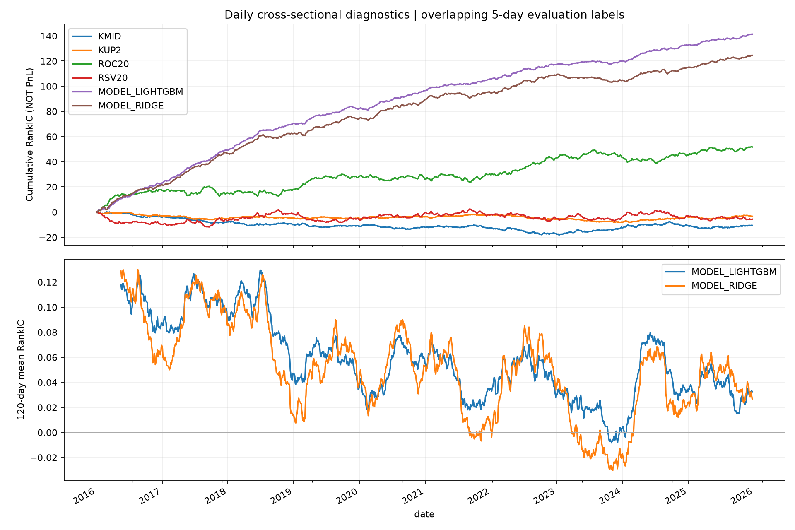
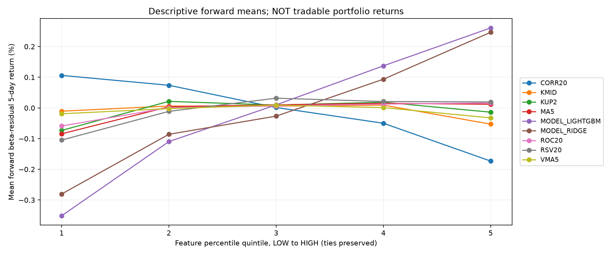
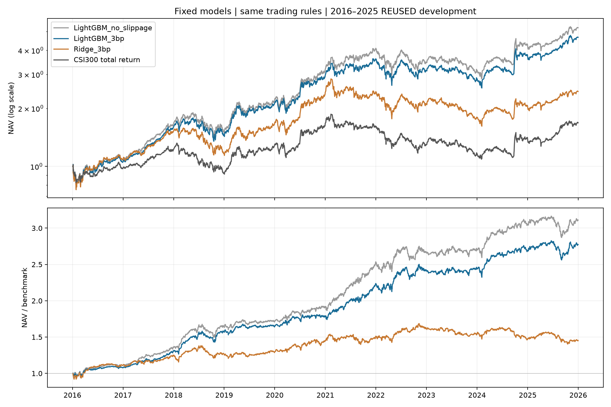
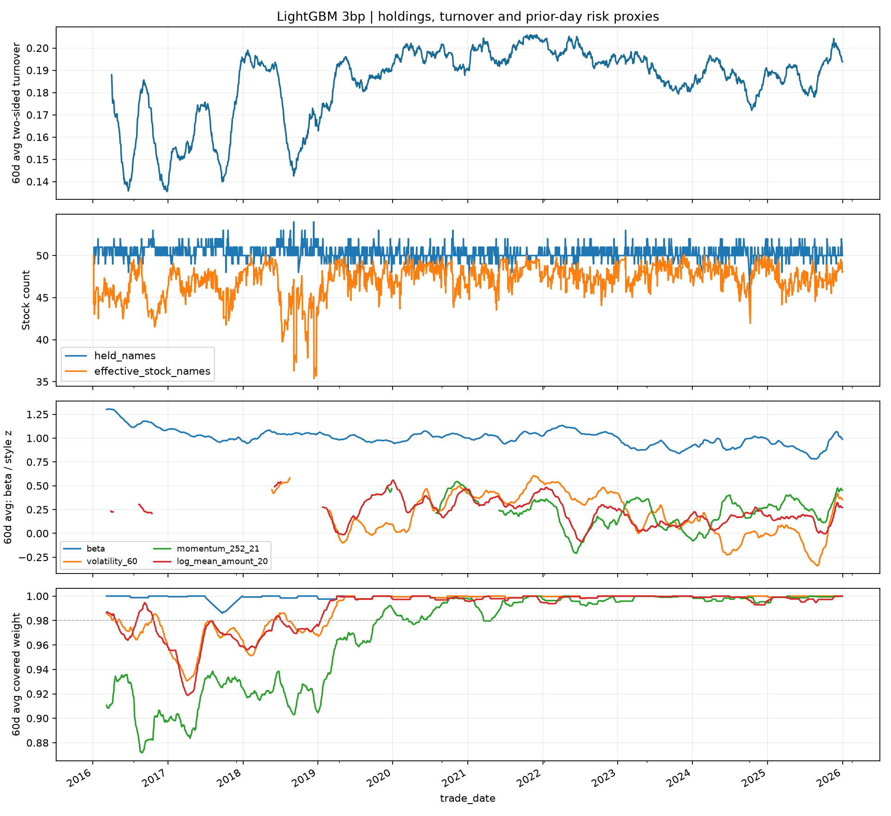

# 从量价数据到可检验的沪深300增强策略

本项目是个人学习与研究项目。现有证据来自历史回测，没有实习团队分工、管理实盘资金或机构生产系统的经历。本轮补充研究证据，保留原LightGBM、标签、预测和交易规则，不根据新的全期统计修改最终模型。

## 1. 数据：先说明每一行在什么时间可知

研究对象不是今天的300只股票回看十年，而是缓存中记录的历史沪深300成员区间。该缓存来自chenditc/investment_data的2026-10-20版本；历史成员记录能减少用当前成分股回看历史的问题，但不代表我们拥有每个历史时点的数据供应商原始版本。复权价格、成员区间、缺失值和单位仍须核对。

特征表的主键是`(datetime, instrument)`，一行表示某只股票在某天收盘后能计算的158项量价特征。股票池与成交可行性是两回事：当日处在研究股票池内，也可能因停牌、涨跌幅方向限制、整手、现金或容量而无法成交。复权统一价格尺度，不会自动解决这些问题。

本轮诊断读取728,716行2016—2025特征。为避免借用2026价格，五日标签只保留2016-01-04至2025-12-23的2,424个信号日；最后标签在2025-12-31退出。完整账户仍有2,430个交易日。IC样本数与交易日数不同是成熟标签截断造成的，不是少跑了回测。

### 时间线和标签

```text
t收盘：计算特征X(t)，用截至t的历史收益估计beta(t)，形成分数与换股计划
t+1收盘：模拟执行；买价=收盘×1.0003，卖价=收盘×0.9997
t+6收盘：五日学习目标的退出价格才最终可知
```

原模型预测目标为：

`y_raw(i,t) = close(i,t+6)/close(i,t+1)-1 - beta(i,t)×[market(t+6)/market(t+1)-1]`。

market是SH000300价格指数。beta使用截至t的252日有效配对收益、60日指数半衰期，至少126对，不足时回退1、不截断。再把`y_raw`在当日股票横截面减均值、除样本标准差，得到训练目标。训练时应根据标签退出日截断，不能只按信号日切训练年份。两个模型的实际最后训练/验证信号日见[训练记录](../results/research/linear_reference/training.json)。

目标中的未来价格只用于训练已成熟标签和事后评价，不能进入当天的特征、预处理或交易计划。目标减去历史beta×未来市场收益是让模型学习相对表现，**不意味着实际持仓已经做市场对冲**。评价账户则使用同首日收盘投入的H00300全收益指数，价格指数训练与全收益指数评价的口径分别明确。

## 2. 因子：从经济直觉到统计证据

Alpha158是公开量价特征集合，并非本项目原创挖掘出158个独立Alpha。其结构是9个K线特征、4个当期价格比例、29类滚动特征×5个窗口。完整表达式见[字典](alpha158_dictionary.csv)。

例如KUP2度量上影线占日内振幅的比例，直觉是冲高回落可能反映卖压；CORR20度量价格和对数成交量的滚动相关性，可能区分不同量价状态。但一个合理故事还必须经过对齐、覆盖率、单因子检验、冗余诊断和组合增量评价，不能凭故事直接入库。

### IC、ICIR与策略IR

| 名称 | 本项目计算 | 回答的问题 |
| --- | --- | --- |
| 日Pearson IC | 当日股票特征与未来五日beta残差收益的横截面相关 | 数值是否线性关联？ |
| 日RankIC | 有效股票配对后，对两侧分别取平均秩，再计算相关 | 排序是否关联？ |
| 因子ICIR | 日RankIC均值/日RankIC样本标准差，不年化 | 排序关联是否稳定？ |
| 全期超额IR | 日净策略收益减日基准收益，其均值/标准差×√252 | 扣费账户的主动收益是否稳定？ |
| 平均年度超额IR | 分别计算十个年度IR后取算术平均 | 用户原先设定的十年年度平均目标如何？ |

不能用因子ICIR代替组合IR，也不能把全期IR与年度IR平均混为一谈。未来五日标签重叠，所以不给因子ICIR机械乘√252来制造“年化显著性”。缺失值先成对删除，再对特征和目标分别排名，至少30对才计算当日IC；不把缺失填0，也不使用全期均值填特征做IC。

本轮七个事先固定的展示特征中，KMID平均RankIC约−0.0043、KUP2约−0.0014，均未通过本轮BY校正；CORR20约−0.0371，校正后q约0.0026。冲高回落的故事没有在这里自动变成显著单因子。负IC表示特征值越高，目标倾向越低，不等于因子无用；但不能看完全期后翻转方向，再把翻转后的表现包装成事前策略。

[全部158项及两种模型的统计](../results/research/report/factor_statistics.csv)保留原始符号、覆盖率、逐年结果、置信区间和多重检验结果。模型预测分数也做同样IC诊断，但不混入158项原始因子的检验族。





第二幅图按特征从低到高分五组；相同值保留相同分位，可能有空组。每个点是先算日内组均值、再等权平均日期。它不是每日可交易组合收益，也没有扣费，不能连乘得到净值。累积RankIC同样不是利润曲线。

### 一个因子从想法到入库的完整门槛

以CORR20作为公开特征案例：明确量价状态假设→写出只用截至t数据的表达式→检查缺失与常量→固定评价目标及方向→看覆盖率、IC、分组及分年变化→检验与既有特征的相关性→在独立时间段验证增量→加入同成本账户→审批版本、冻结规则、上线监控。本项目已完成的是历史诊断及模型整体回测；**没有因为本次CORR20全期统计好，就宣称它单独通过真实新样本入库**。

因子衰减要先区分数据问题和经济关系变化。检查字段/复权/成员变化、缺失率、特征分布、每日IC、分组差、换手和成本，再判断是短期波动、拥挤、市场结构变化还是模型退化。120日滚动IC图只是观察工具，尚未部署自动停用规则；若设预警阈值，要在下一段未观察的数据到来前固定。

## 3. 冗余和过拟合：为什么不能只报最好的一条曲线

用120个月各自最后一个成熟信号日计算横截面Spearman相关，再分别平均带符号相关和绝对相关。这样避免将不同股票、日期混在一起算出难解释的总体相关。月度抽样是计算量折中，不等于检查了所有交易日。

本轮发现VSUMP5、VSUMN5、VSUMD5等存在接近±1的排序相关，符合这些方向占比之间的代数关系。见[全部相关对](../results/research/report/correlation_pairs.csv)。高相关会让特征重要性在替代变量间分摊，不能把“重要性低”直接解释为无经济信息。

线性模型可以用Ridge抑制不稳定系数。若需精简特征，可以按训练段相关性聚类，每组选覆盖好、稳定、计算简单的代表；若需要保留某特征相对已有因子的增量，可以在训练段回归后取残差。正交化有顺序依赖，且可能删掉有用交互；树模型也不需要一律正交化。任何选择或残差化规则都应在训练段确定，不能用2016—2025全期相关矩阵筛选后再报告同一段收益为样本外。

### 本轮实际做了什么统计检验

固定圆形连续块Bootstrap：块长20日、19,999次、随机种子20261027。每个样本由连续20日块拼接，末尾可绕回开头，恰好抽取原长度。它保留块内相邻日相关，比逐日独立抽样更适合重叠标签；但仍近似依赖块长选择和过程稳定性，不能保证保留所有长周期关系。实现思路参照[arch圆形块抽样说明](https://bashtage.github.io/arch/bootstrap/generated/arch.bootstrap.CircularBlockBootstrap.html)，不是随机几何块长的stationary bootstrap。

原假设为每个特征的平均RankIC=0，双侧检验；将Bootstrap均值减去原样本均值构造近似零假设分布，p值使用加1修正，最小分辨率0.00005。对预先声明的158项做Benjamini–Yekutieli（BY，常被称为BHY）校正，FDR阈值5%，得到32项拒绝。BY允许检验间一般依赖，但其保证依赖各p值有效；本项目Bootstrap p值本身是时间序列近似。见[statsmodels方法说明](https://www.statsmodels.org/stable/generated/statsmodels.stats.multitest.multipletests.html)。

32项不代表32个独立赚钱策略，也不代表它们未来有效。检验只覆盖当前158项，并未校正此前反复尝试的所有标签、持仓、优化器和策略版本。2016—2025已经是反复使用的开发区间，本轮没有创造新的独立样本外；2026此前已经揭示的结果也不能重新当作未见数据。

LightGBM每边3bp的全期IR为1.344，20日块Bootstrap的描述性95%区间约[0.780, 1.925]。它是**全期IR**的区间，不是平均年度1.378的区间，更不是将来收益承诺。不能把事后统计检验当成“确认没有过拟合”。

## 4. 模型：树模型究竟比线性基线好在哪里

这次新增固定Ridge参考，使用完全相同的158特征、残差标签、训练/验证样本和两个应用时间段。逐段核对原训练数据的行索引和特征值指纹。均值、标准差、缺失填补均只拟合训练段，标准化后截到±5；目标函数为平均平方误差+1×系数平方和，截距不惩罚。λ和截断值固定，没有根据验证或回测寻找最优值。

LightGBM沿用原缺失值处理与特征输入，不为了对照改变原模型。Ridge需要自己的训练段预处理，因此这个实验比较两条完整建模流程，不能单独证明所有收益差异都由“非线性”造成。

| 2016—2025，同交易规则 | 平均年度超额IR | 全期超额IR | 年化收益 | 最大绝对回撤 |
| --- | ---: | ---: | ---: | ---: |
| LightGBM，基础费用无滑点 | 1.532 | 1.489 | 18.01% | −30.50% |
| LightGBM，每边3bp成交价滑点 | 1.378 | 1.344 | 16.66% | −29.47% |
| 固定Ridge，每边3bp成交价滑点 | 0.429 | 0.486 | 9.36% | −43.15% |



LightGBM平均RankIC约0.0583，Ridge约0.0514。排序指标的差距比最终IR差距小，说明还应检查头部股票排序、持仓路径、风险和交易成本，不能用全横截面IC直接换算组合利润。树模型能够表达阈值和交互，线性模型只能做给定特征的加权和；本轮事实是原LightGBM流程优于这一个固定Ridge参考，没有比较神经网络，也没有证明它优于全部传统模型。

同一次连续块抽样同步重抽两个模型日期，LightGBM减Ridge的全期IR差值约0.858，描述性95%区间[0.420, 1.299]；平均RankIC差值约0.00692，区间[0.00036, 0.01359]。配对抽样保留共同市场日期，但仍不能修复开发期反复选择造成的偏差。

防止样本外崩溃的方法是按时间切分、按标签退出日隔离边界、预处理只拟合训练段、限制模型复杂度、冻结规则、记录所有失败试验、用同成本线性基线以及后续真实未见时间验证。年年更新或更复杂优化器不是天然改进。本轮不因新统计调整原模型，也不把历史比较结果变成新的实盘承诺。

## 5. 组合、风险和执行：收益从哪里来、能做多大

当前组合是约50只股票、每日通常最多替换5只的新买入预算规则。不是每日等权，也没有硬性的单股2%上限、行业中性或跟踪误差优化器。价格变化会让权重漂移，不能因为“50只股票”就认为集中度受严格控制。本轮增加持股数、最大单股权重、有效股票数`(Σw)²/Σw²`，见[执行表](../results/research/report/daily_execution.csv)。

### 已实现的风险分析与完整Barra的差别

本轮计算前一收盘持仓对历史beta、60日波动、252日至21日前动量、20日平均成交额对数的暴露。后三项用当日沪深300**等权横截面**均值/标准差转成z分数；股票绝对beta直接加权，现金beta视为0。使用前一日持仓及当时数据，避免用当天交易后权重解释当天风险。若某项可覆盖持仓权重低于98%，该日暴露留空，并保存覆盖率；beta不足的回退值单列标记。

这里的成交额是流动性代理，不是市值；252−21日简单动量也不是商业Barra原始描述子。没有完整历史行业、可用时点市值/基本面和指数权重，所以不能计算完整行业/风格主动暴露，不能声称行业中性。单市场时间序列回归得到的组合beta约1.061、截距×252约10.72%，也是描述性结果，没有控制其他系统性风险，更不能把截距称为纯选股Alpha。

完整特征型风险模型先根据可用时点特征构造暴露矩阵X，再用股票收益的横截面回归估计因子收益f和特质收益u：`r=Xf+u`。一般不能把这一步说成同时估计所有未知暴露和因子收益。其协方差为`Σ=XFXᵀ+D`；组合暴露`Xᵀw`，相对指数主动权重`a=w−w_b`，主动暴露`Xᵀa`，跟踪方差`aᵀΣa`。参考[MSCI暴露方法](https://www.msci.com/www/research-report/measuring-factor-exposures/01600028385)及[MOSEK因子风险说明](https://docs.mosek.com/portfolio-cookbook/factormodels.html)。

未来具备数据后可以优化`max αᵀa − λ aᵀΣa − γ×交易成本`，约束资金、long-only、单股主动偏离、行业/风格暴露、跟踪误差、换手、可交易性及容量。预测分数须先转换或校准为与风险和成本一致的收益尺度；不能把排序分数直接当年化Alpha。完整矩阵和权重数据尚缺，本轮没有给现有策略补一个名不副实的Barra优化器。



### 成本和容量的实际证据

原费用买入5bp、卖出15bp、每笔最低5元。在真实滑点实验中买价上移3bp、卖价下移3bp，基础费用按滑后成交金额计算，股票按未偏移收盘估值，不再加扣一次滑点费用。价格超出当日高低价范围拒单，实际成交量和成交额各不得超过日总量/额5%。日线模型仍无法重放收盘竞价盘口，也未建模随规模变化的市场冲击。

双边换手定义为当日买卖实际成交金额之和/前一日净值，初始建仓也计入。十年平均每年约44.86倍；单边“半双边”约22.43倍，必须交代口径。年度平均基础费用日占比之和约4.48%，成交价滑点损失日占比之和约1.35%。这些是按每日前净值归一的归因加总，不能直接从十年CAGR减去，也不能替代全账户对照；滑点拒单会改变后续持仓路径。

保持已成交路径不变，将金额和数量静态放大：初始1亿元路径的2倍约15.86%成交金额位于突破5%日容量限制的股票日，5倍约47.48%。这证明放大规模存在执行压力，**没有得到“最大容量2亿元”**。压力测试基于已经被容量规则截断后的成交，不能衡量未成交需求；也没有重算现金、后续持仓、拒单、成本或竞价可用量。

历史失效状态按前一日已知的200日均线和60日年化波动25%阈值描述，不改变仓位。结果见[状态表](../results/research/report/conditional_regimes.csv)。不同状态样本长度不等，高波动上涨状态只有154天；条件IR不是这些分散日期可以单独交易出的净值，也不能看完结果直接新增择时规则。

## 6. 下一步：把改进变成可证伪的研究

本轮发现的优先问题是高换手、部分特征冗余、权重漂移和缺少完整基准主动风险控制。可对应提出：训练段相关性压缩、成本敏感的换股门槛、持仓集中度约束、数据补齐后的主动风险优化。每项都应一次只改变一个环节、提前规定评价指标，在同样费用与执行规则下检查收益、IR、回撤和容量；本轮先记录这些假设，不再用开发期反复调参追IR目标。

如果回测好但实盘差，先逐层对账：数据到达与版本→信号差异→目标持仓→订单→成交/拒单→现金/复权/费用→基准与收益归因，再排查模型关系是否变化。滑点、成交时点和容量可能解释收益落差，不能把一切归为“因子失效”。

舆情、卫星、订单流等另类数据尚未接入。可行研究首先需要合法来源、发布时间与修订时间、实体映射、历史覆盖，构造截至信号时点可知的特征，再与现有模型做真正时间外的增量对照。现在不能写“使用了这些数据”或编造提升数字。

可复算入口：在仓库根目录运行`python run.py research-report --output runs/research-report`，可从保存统计重建表格和五张图；这不是重新生成特征或成交。`research-backtest`重新执行固定Ridge账户，需要原始行情。原始特征缓存由用户本地提供，`research-build`的输入格式和可复现边界见[实验记录](../results/research/README.md)。
