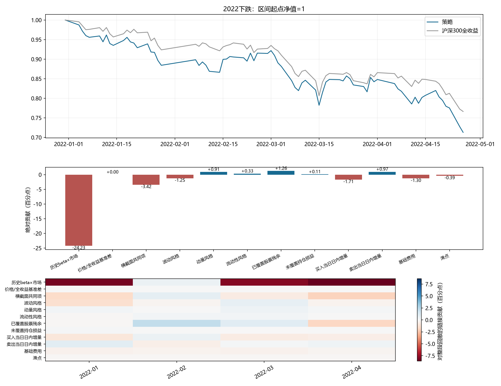
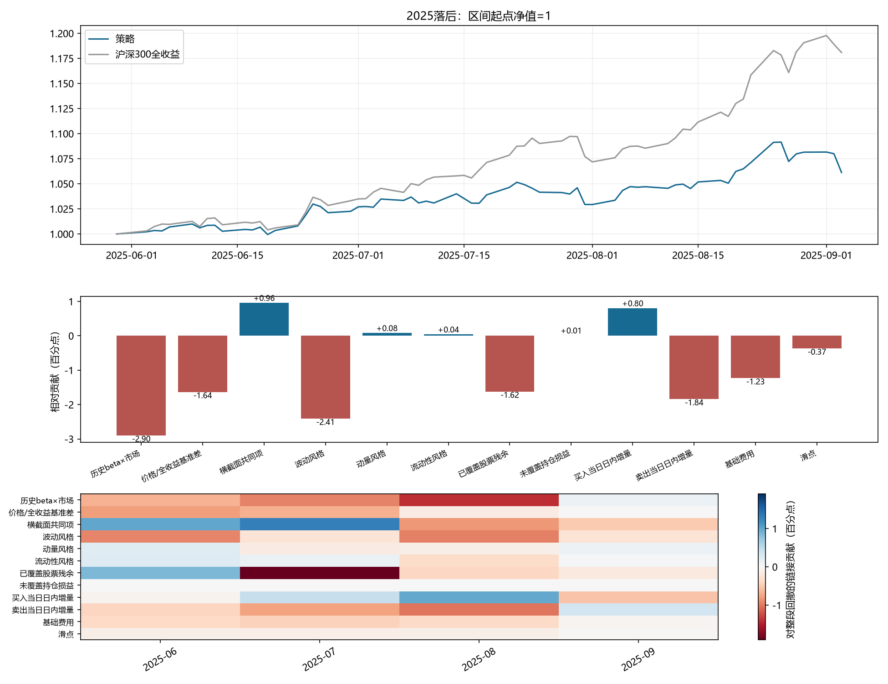
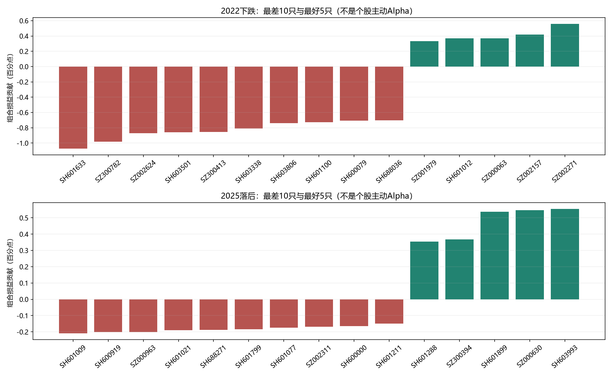
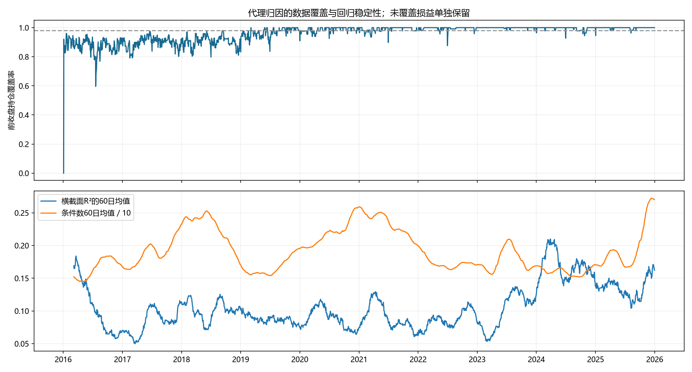

# 持仓、风格、交易与回撤的详细归因

本报告进一步解释上一版“非市场毛分量”。对象仍为2016—2025冻结LightGBM、t+1开盘、每边3bp滑点的同一账户；没有修改模型、交易、持仓或净值。

## 先说明：哪些是账目事实，哪些依赖模型

- **账目恒等式**：逐笔交易、逐股损益、费用、滑点、买卖当日增量和峰谷回撤，可与原账户精确核对。
- **代理解释**：历史beta、波动、动量、流动性及横截面共同项来自简化归因模型。它们解释同一损益的不同部分，数值依赖所选因子和拟合方法。
- **仍无法识别**：真实历史指数权重下的行业配置/选股效应、规模/价值/盈利风格，以及完整Barra特质风险。没有用现在行业分类冒充历史分类，也不将未解释项称为纯Alpha。

## 一、损益分解是怎样算出来的

对每只股票和每一天，以复权单位计算：

```text
旧持仓收益 = 昨日股数 ×（今日收盘估值 − 昨日收盘估值）
买卖当日增量 = 股数变动 ×（今日收盘估值 − 今日开盘参考价）
实际净损益 = 旧持仓收益 + 买入当日增量 + 卖出当日增量 − 基础费用 − 滑点
```

这与“旧持仓隔夜损益 + 开盘后持仓日内损益 − 成本”完全等价。买入当日增量为正表示新增股份当日赚到钱；卖出当日增量为负表示卖出的股份后来当日上涨，形成机会损失。它只比较当天，不证明不换仓长期更好，不能累计成独立可交易策略。

再将旧持仓收益拆为历史beta对应的市场分量、横截面共同项、波动风格、动量风格、流动性风格、已覆盖股票残余和未覆盖持仓损益。开盘换仓增量独立保留，避免用收盘新持仓权重倒推全天风险。

## 二、逐段贡献明细

| 分量 | 2022峰谷：绝对贡献 | 2025峰谷：相对贡献 |
| --- | ---: | ---: |
| 历史beta×市场 | -24.228个百分点 | -2.900个百分点 |
| 价格/全收益基准差 | +0.000个百分点 | -1.637个百分点 |
| 横截面共同项 | -3.417个百分点 | +0.958个百分点 |
| 波动风格 | -1.254个百分点 | -2.411个百分点 |
| 动量风格 | +0.915个百分点 | +0.080个百分点 |
| 流动性风格 | +0.334个百分点 | +0.039个百分点 |
| 已覆盖股票残余 | +1.264个百分点 | -1.623个百分点 |
| 未覆盖持仓损益 | +0.109个百分点 | +0.011个百分点 |
| 买入当日日内增量 | -1.706个百分点 | +0.802个百分点 |
| 卖出当日日内增量 | +0.968个百分点 | -1.843个百分点 |
| 基础费用 | -1.302个百分点 | -1.234个百分点 |
| 滑点 | -0.391个百分点 | -0.370个百分点 |

合计分别为-28.71%和-10.13%。绝对贡献与相对贡献分母不同，不横向直接比较。相对市场行按价格指数衡量beta偏离；价格指数与全收益基准的差异另列，不混进选股或beta失配。

### 2022年：系统性下跌为主，换仓和成本加深回撤

市场分量为-24.23个百分点，共同项-3.42个百分点。三类风格合计-0.01个百分点：波动风格拖累，被动量与流动性分量部分抵消。已覆盖股票残余贡献+1.26个百分点。因此，这个代理模型不支持把整次回撤简单归结为“模型个股选择全面失效”。

开盘买入新增股份当日贡献-1.71个百分点，卖出避免部分后续当日下跌、贡献+0.97个百分点；两者合计-0.74个百分点，再叠加-1.69个百分点交易成本。卖出在当天起到了部分防御作用，买入和成本抵消了这部分收益。

### 2025年：低敏感度、低波动暴露和交易拖累同时出现

相对回撤中，按价格指数衡量的市场敏感度偏离贡献-2.90个百分点，价格/全收益基准差贡献-1.64个百分点，波动风格贡献-2.41个百分点，已覆盖股票残余贡献-1.62个百分点。此前看到的低beta不是全部原因，风格和股票残余仍占重要部分。

买入新增股份当日贡献+0.80个百分点，卖出当日增量贡献-1.84个百分点，说明该阶段确实存在成交当天“卖后上涨”的总体机会损失。两项净增量与交易成本合计-2.65个百分点。这里不能推出“所有卖单都错了”或“长期不换股更好”。

原模型预测五日收盘残差收益，实际在次日开盘换仓；当天增量不是模型完整预测期限。标签与执行持有期不一致是需要独立检验的假设，现有归因不能把它直接认定为根因。





## 三、回撤在哪些月份形成

| 阶段 | 月份 | 策略收益 | 基准收益 | 当月相对收益 | 对整段回撤的贡献 |
| --- | --- | ---: | ---: | ---: | ---: |
| 2022下跌 | 2022-01 | -11.57% | -7.62% | -4.27% | -11.570个百分点 |
| 2022下跌 | 2022-02 | 3.43% | 0.39% | 3.03% | +3.033个百分点 |
| 2022下跌 | 2022-03 | -7.92% | -7.83% | -0.09% | -7.243个百分点 |
| 2022下跌 | 2022-04 | -15.35% | -10.35% | -5.57% | -12.929个百分点 |
| 2025落后 | 2025-06 | 2.26% | 3.31% | -1.02% | -1.022个百分点 |
| 2025落后 | 2025-07 | 0.67% | 4.27% | -3.45% | -3.419个百分点 |
| 2025落后 | 2025-08 | 5.06% | 10.52% | -4.94% | -4.720个百分点 |
| 2025落后 | 2025-09 | -1.87% | -0.81% | -1.07% | -0.968个百分点 |
| 2023—2024落后 | 2023-07 | 2.29% | 4.50% | -2.11% | -2.115个百分点 |
| 2023—2024落后 | 2023-08 | -5.90% | -6.02% | 0.13% | +0.129个百分点 |
| 2023—2024落后 | 2023-09 | -3.02% | -1.96% | -1.08% | -1.060个百分点 |
| 2023—2024落后 | 2023-10 | -4.89% | -3.10% | -1.85% | -1.798个百分点 |
| 2023—2024落后 | 2023-11 | -0.43% | -2.11% | 1.72% | +1.639个百分点 |
| 2023—2024落后 | 2023-12 | -1.46% | -1.76% | 0.31% | +0.296个百分点 |
| 2023—2024落后 | 2024-01 | -8.61% | -6.29% | -2.48% | -2.407个百分点 |
| 2023—2024落后 | 2024-02 | -3.03% | -0.46% | -2.58% | -2.444个百分点 |

月份按区间边界截取，首尾月不一定是完整自然月。“对整段贡献”使用整段起点的净值链接，能够相加；当月收益各自复利，不能简单相加。

## 四、哪些股票拖累，是否是一两只股票造成的



### 2022下跌

发生负贡献的股票144只，合计-35.73个百分点；正贡献股票58只，合计+7.02个百分点。两者相加等于策略区间收益-28.71%，并非相对收益。

| 股票 | 组合净损益贡献 |
| --- | ---: |
| SH601633 | -1.072个百分点 |
| SZ300782 | -0.984个百分点 |
| SZ002624 | -0.872个百分点 |
| SH603501 | -0.859个百分点 |
| SZ300413 | -0.857个百分点 |
| SH603338 | -0.809个百分点 |
| SH603806 | -0.741个百分点 |
| SH601100 | -0.727个百分点 |
| SH600079 | -0.709个百分点 |
| SH688036 | -0.702个百分点 |
### 2025落后

发生负贡献的股票102只，合计-6.67个百分点；正贡献股票109只，合计+12.80个百分点。两者相加等于策略区间收益6.13%，并非相对收益。

| 股票 | 组合净损益贡献 |
| --- | ---: |
| SH601009 | -0.210个百分点 |
| SH600919 | -0.202个百分点 |
| SZ000963 | -0.202个百分点 |
| SH601021 | -0.189个百分点 |
| SH688271 | -0.189个百分点 |
| SH601799 | -0.183个百分点 |
| SH601077 | -0.175个百分点 |
| SZ002311 | -0.169个百分点 |
| SH600000 | -0.164个百分点 |
| SH601211 | -0.149个百分点 |

在上涨中落后时，拖累不只来自亏损股票，也可能来自没有持有涨幅更大的股票。缺少历史指数个股权重，不能从“组合最差股票”表反推出全部跑输原因。

## 五、买错还是卖飞：只看成交当天的可核对增量

本表各区间均为对起点组合资产的**绝对损益贡献**；2025主表使用相对净值，链接权重不同，所以数字不完全相同。

| 阶段 | 方向 | 有成交订单数 | 当日增量为正的比例 | 毛增量 | 基础费用 | 滑点 |
| --- | --- | ---: | ---: | ---: | ---: | ---: |
| 2022下跌 | 买入 | 361 | 46.0% | -1.706pp | -0.325pp | -0.195pp |
| 2022下跌 | 卖出 | 370 | 53.2% | +0.968pp | -0.977pp | -0.195pp |
| 2025落后 | 买入 | 318 | 51.6% | +0.868pp | -0.331pp | -0.198pp |
| 2025落后 | 卖出 | 326 | 46.0% | -1.939pp | -0.994pp | -0.199pp |
| 2023—2024落后 | 买入 | 688 | 44.2% | -2.372pp | -0.632pp | -0.379pp |
| 2023—2024落后 | 卖出 | 709 | 54.0% | +1.517pp | -1.901pp | -0.380pp |
| 2022—2024修复 | 买入 | 2852 | 49.3% | +11.150pp | -3.588pp | -2.152pp |
| 2022—2024修复 | 卖出 | 2937 | 52.2% | -2.621pp | -10.785pp | -2.158pp |

这里的“卖出增量为正”指卖掉之后当日下跌，避免了部分损失；不是卖出盈利比例，也不是策略胜率。成交额、最低手续费、实际成交数量都按原订单记录，没有按计划数量替代成交数量。

## 六、最差交易日与尾部集中度

### 2022下跌：按策略单日净收益排序

最差10天对区间起点资产的损益贡献合计-28.23个百分点。它是损失日集中程度，不是10天独立策略回撤。

| 日期 | 策略单日收益 | 基准单日收益 | 算术超额 | 买卖当日毛增量 |
| --- | ---: | ---: | ---: | ---: |
| 2022-04-25 | -6.16% | -4.94% | -1.22% | -0.23% |
| 2022-03-15 | -4.72% | -4.57% | -0.15% | -0.40% |
| 2022-03-07 | -4.11% | -3.19% | -0.92% | 0.04% |
| 2022-04-11 | -3.96% | -3.09% | -0.87% | 0.08% |
| 2022-03-14 | -2.98% | -3.06% | 0.08% | 0.09% |
### 2025落后：按策略单日净收益排序

最差10天对区间起点资产的损益贡献合计-9.37个百分点。它是损失日集中程度，不是10天独立策略回撤。

| 日期 | 策略单日收益 | 基准单日收益 | 算术超额 | 买卖当日毛增量 |
| --- | ---: | ---: | ---: | ---: |
| 2025-08-27 | -1.77% | -1.49% | -0.28% | 0.13% |
| 2025-09-03 | -1.73% | -0.68% | -1.05% | -0.16% |
| 2025-07-31 | -1.59% | -1.80% | 0.22% | -0.06% |
| 2025-06-19 | -0.73% | -0.81% | 0.08% | -0.19% |
| 2025-06-27 | -0.60% | -0.55% | -0.05% | -0.03% |

## 七、为什么恢复花了很长时间

2022-04-26谷底至2024-09-30首次恢复前高，策略累计上涨53.20%，基准同期14.36%。下跌28.71%需要上涨约40.27%才能回本；实际恢复日的上涨可能越过前高，所以实现的53.20%修复涨幅不必等于最低回本门槛。恢复期间不是持续下跌，而是反弹、再次回落与再修复交替；月度表保留整个路径。

| 修复阶段分量 | 对谷底起点资产的贡献 |
| --- | ---: |
| 历史beta×市场 | +19.838个百分点 |
| 价格/全收益基准差 | +0.000个百分点 |
| 横截面共同项 | +12.375个百分点 |
| 波动风格 | +2.155个百分点 |
| 动量风格 | +5.884个百分点 |
| 流动性风格 | -2.710个百分点 |
| 已覆盖股票残余 | +24.424个百分点 |
| 未覆盖持仓损益 | +1.393个百分点 |
| 买入当日日内增量 | +11.150个百分点 |
| 卖出当日日内增量 | -2.621个百分点 |
| 基础费用 | -14.373个百分点 |
| 滑点 | -4.310个百分点 |

## 八、回归方法、覆盖率和解释边界

每天使用前一交易日历史沪深300成员的beta、60日波动、252−21日动量及20日成交额对数；后三项按该日前成员横截面均值/样本标准差转成z分数。beta必须有至少126对有效历史样本；回退为1的样本不进入该回归。

| 暴露 | 具体计算 | 如何理解 |
| --- | --- | --- |
| beta | 252日配对收益、指数半衰期60日，至少126对观测 | 对SH000300价格收益的历史敏感度 |
| 波动 | 60日收盘收益样本标准差×sqrt(252)，至少40日 | z<0为低于当日成员平均波动 |
| 动量 | close(t−21)/close(t−252)−1 | 跳过最近一月的长期涨幅代理 |
| 流动性 | log(20日平均人民币成交额)，至少15日 | 正z代表成交额较大，不等于盘口冲击已被度量 |

例如2025阶段波动暴露为负，且波动风格收益对组合贡献为负，说明该代理模型将部分落后关联到低波动持仓；不能把这个系数直接解释成投资者风险偏好变化的因果证据。三个风格一起回归，未强行正交化，系数是控制其余代理后的条件关联。

```text
r_i,t − beta_i,t−1 × r_SH000300,t
    = a_t + z_vol,i,t−1 × f_vol,t + z_mom,i,t−1 × f_mom,t
          + z_liq,i,t−1 × f_liq,t + epsilon_i,t
```

用至少100只有完整暴露及当日收益的股票做等权OLS，并记录设计矩阵条件数（要求≤1e6）。因子收益在当天结束后估计，仅用于事后解释，绝不用于原交易决策。共同项不是无风险收益，残余不是纯个股Alpha；行业、规模、估值等遗漏风险可能落入任意代理分量。价格指数用于历史beta和市场归因，全收益指数用于账户评价；两者差异另列。价格/全收益差反映基准口径，不是可以通过调模型消除的交易损失。

| 区间 | 平均持仓权重覆盖 | 最低覆盖 | 低于98%的天数 | 回归样本数中位数 | 最大条件数 |
| --- | ---: | ---: | ---: | ---: | ---: |
| 2022下跌 | 99.68% | 97.91% | 3 / 74 | 295 | 1.84 |
| 2025落后 | 99.58% | 96.32% | 1 / 67 | 297 | 2.28 |
| 2023—2024落后 | 99.88% | 96.47% | 4 / 142 | 300 | 2.10 |
| 2022—2024修复 | 99.71% | 87.59% | 47 / 591 | 299 | 2.44 |

前收盘已覆盖持仓的平均暴露如下（每天先除以已覆盖股票权重，再取时间均值；用于描述，不用于放大贡献）：

| 区间 | beta | 波动z | 动量z | 流动性z |
| --- | ---: | ---: | ---: | ---: |
| 2022下跌 | 1.127 | 0.433 | 0.004 | 0.220 |
| 2025落后 | 0.779 | -0.352 | 0.144 | 0.035 |
| 2023—2024落后 | 0.893 | 0.136 | 0.057 | 0.164 |
| 2022—2024修复 | 0.956 | 0.154 | 0.149 | 0.139 |

未覆盖持仓损益按账目原值单列，**不补零、不放大剩余股票权重、不把全部损益强行分给风格**。因此这是部分覆盖的代理归因，不是完整Barra。风险表使用实际分量与净收益的协方差贡献，允许负值，不能假设各分量彼此独立。



## 九、全期风险方差来自哪里

风险归因与回撤损益归因不是同一问题。下表计算每个日收益分量与总净收益（或日净超额）的协方差，除以对应总方差；排除首个建仓日。各列合计100%，可以出现负贡献，说明该分量对波动有抵消作用。费用的方差贡献接近0不代表费用没有拖累收益。

| 分量 | 绝对收益方差贡献 | 净超额收益方差贡献 |
| --- | ---: | ---: |
| 历史beta×市场 | 80.73% | 7.15% |
| 价格/全收益基准差 | 0.00% | 0.04% |
| 横截面共同项 | 3.40% | 26.02% |
| 波动风格 | 1.79% | 13.53% |
| 动量风格 | 0.95% | 3.07% |
| 流动性风格 | -0.19% | -2.95% |
| 已覆盖股票残余 | 8.32% | 40.70% |
| 未覆盖持仓损益 | 4.09% | 6.84% |
| 买入当日日内增量 | 7.80% | 11.43% |
| 卖出当日日内增量 | -6.90% | -5.81% |
| 基础费用 | -0.01% | -0.01% |
| 滑点 | -0.00% | -0.00% |

这比上一版单市场回归更细，但不是唯一划分。新增风格、共同项和独立开盘换仓增量后，部分原“市场/非市场”会重新分配；总收益、总风险和净值没有改变。不能把此表的残余视为没有任何系统性风险，也不能当作未来风险预测。

## 十、归因对应的研究问题（本轮不修改策略）

| 观察到的问题 | 下一步可检验的方案 | 为什么不能直接据此改参数 |
| --- | --- | --- |
| 2022市场敏感度较高，2025上涨阶段敏感度偏低 | 以历史基准为参照约束beta漂移，而非单方向压低仓位 | 单纯低beta可能降低熊市损失，也可能扩大上涨中的相对回撤 |
| 波动风格在两个重点区间有负贡献 | 在组合构建中监控波动代理与历史基准暴露偏离 | 低波动或高波动都不是永远占优，缺少真实基准权重时不能声称风格中性 |
| 买卖当日净增量不足覆盖成本 | 检验换股缓冲和经训练段校准的预期收益/成本门槛 | 原模型分数没有收益率单位，不能直接拿分差与bp比较 |
| 原五日收盘标签与开盘执行存在持有区间差异 | 独立检验与实际执行时点一致的预测标签 | 成交当天归因不能证明完整五日信号失效，需要重新切分与验证 |
| 2017之后模型一直冻结 | 预先固定滚动更新方案，在新时间段检验稳定性 | 不能用已见回撤挑更新日期或只保留胜出的模型 |
| 缺少历史行业和真实指数权重 | 补充时点一致的数据后做行业配置/选择分解 | 不能用当前行业分类或等权股票池替代真实历史指数 |

价格/全收益基准差是口径解释，不能通过改用价格指数来美化结果。完整归因提高问题定位能力，并不证明上述改进必然提高样本外收益。

## 十一、可复算材料

`daily_components.csv`保留12个归因槽位（绝对收益中基准口径差为0，相对收益中显式启用）；`window_attribution.csv`为绝对和相对两种精确链接；`monthly_attribution.csv`为月度路径；`stock_contributions.csv`为个股贡献；`tail_days.csv`为最差收益/超额日；`execution_summary.csv`及`trade_diagnostics.parquet`保留成交增量；`realized_risk_contributions.csv`给出全期风险方差贡献。

```bash
python -m src.deep_attribution report --input results/deep_attribution --output runs/deep-report
python -m src.deep_attribution build --data-dir /path/to/qlib_data --output runs/deep-rebuild
```

新输出目录必须不存在。输入和原始行情指纹、逐日净收益核对误差见`provenance.json`。这轮提供的是对既有回测的更细解释，没有用归因结果修改模型；2016—2025仍是复用开发区间。方法参考：[MOSEK因子模型说明](https://docs.mosek.com/portfolio-cookbook/factormodels.html)。
