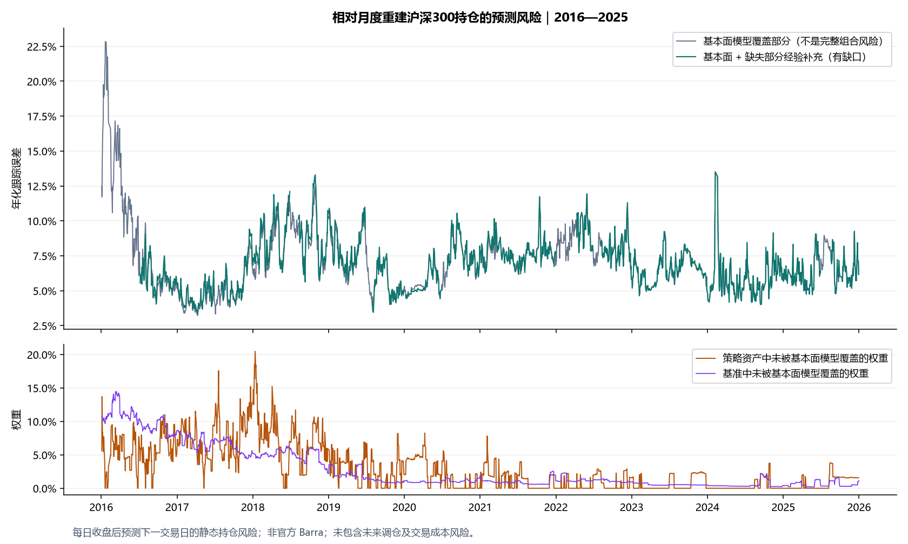
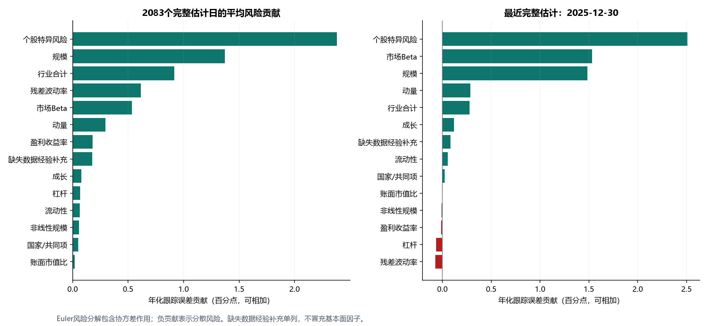
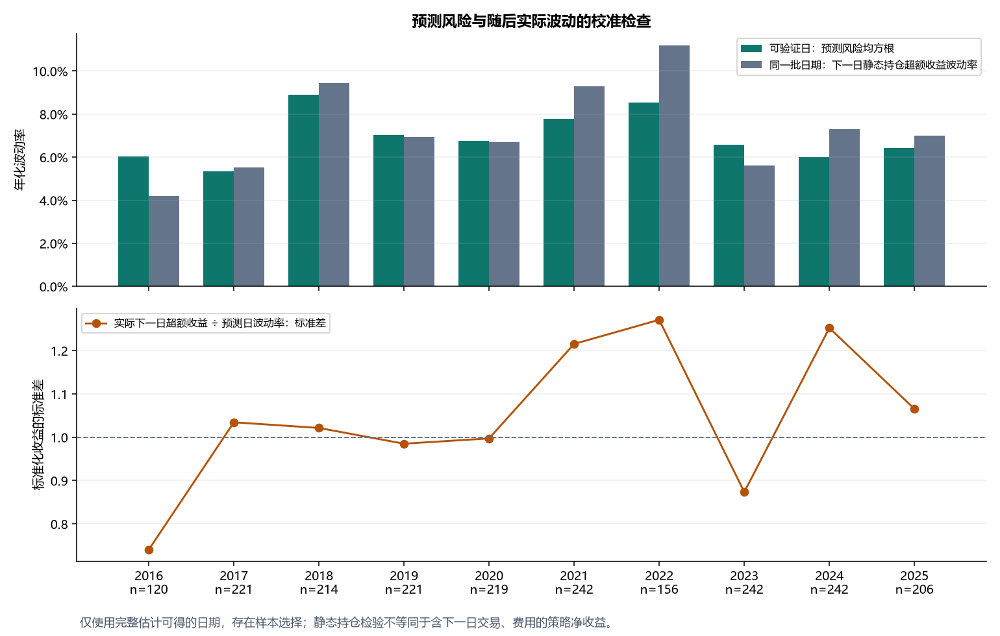

# 指数增强项目：预测风险归因报告

生成日期：2026-11-06。对象：冻结的 risk_net_edge_mean 候选账户，2016-01-04—2025-12-31，2430个交易日。原预测、持仓、成交与费用规则未改动；这不是新一轮策略优化。原账户平均年度超额IR约1.579，未因本风险分析重新计算或替换。

## 预测风险的计算口径

上一份报告解释已经发生的超额收益，以及已实现收益分项的事后方差。这一次实际计算了截至每个历史收盘时点的因子协方差 F、个股特异方差 D、当前主动暴露及下一交易日静态持仓的预测跟踪误差，并分解风险来源。它回答“当前组合的未来风险从哪里来”，不能解释成“过去收益有多少来自Alpha”。

这是免费数据构建的十风格+行业基本面风险模型，另有明确标记的缺失数据经验补充；不是MSCI官方Barra。官方的模型数据构件包括暴露、因子协方差和特异风险，见[MSCI模型数据示例](https://developer.msci.com/code-libraries/models-via-snowflake-python-notebook)。本项目的估计方法和口径以下列实现为准，不宣称复刻官方专有方法。

## 结果及覆盖范围

- 基本面覆盖部分：2430日均可计算，平均预测年化TE **7.10%**。未覆盖资产没有删掉后重新归一化；所以这个数不是完整组合的TE，也不保证是完整风险的下界。
- 基本面+经验补充：**2083/2430日**可计算，平均预测年化TE **6.80%**。同一批日期的基本面覆盖部分平均TE为6.70%。不能把它与2430日的平均TE直接比较后解释为“加入股票降低风险”。
- 其余347日：缺失部分与现有主动持仓共同可用的历史收益不足126日，没有给出完整组合风险点估计。缺口逐日保留，不画连线或当成零。
- 基本面未覆盖的策略资产权重：平均2.90%，最大20.48%；未覆盖的基准权重平均2.84%。经验补充能估计部分缺口的整体风险，不能补出缺失的行业/风格解释。
- 最近完整估计 **2025-12-30**：年化TE **6.21%**，共同因子贡献3.622个百分点、特异风险2.508个百分点、缺失数据经验块0.084个百分点。
- 样本最后一天 **2025-12-31**：仅覆盖部分TE **6.15%**；策略资产1.56%、基准1.13%未被基本面覆盖。完整组合点估计不可得，不以12月30日数值替代。具体股票及缺失原因见last_uncovered_active_names.csv。其中SH601989在原账户仍有约1.56%权重，市值、行业和风格描述符缺失；价格沿用的账面持仓不能据此解释为可交易或没有风险。



## 计算路径与时间顺序

1. t日收盘后取真实账户收盘持仓权重 w_p,t 和月度快照重建的基准收盘权重 w_b,t，主动权重 a=w_p−w_b。剩余现金收益风险按零处理，未单列现金因子。使用t日信息预测下一交易日，在日内调仓之前的持仓风险。
2. 暴露 X_t 由t日及之前的价格、已知股本和保守公告/更新日期筛选的财务记录生成。没有借用 t+1 回报是否存在来决定t日暴露是否可用。风格为规模、非线性规模、Beta、动量、残差波动率、流动性、账面市值比、盈利收益率、成长、杠杆；含国家共同项及历史CSRC大类行业。标准化和正交化沿用前一份归因定义。
3. 历史每个s日用 X_(s−1) 对 r_s 做约束横截面回归，得到 f_s、u_s。增加2015年244个成功拟合日作为2016年初的风险预热。估计样本是可得的历史指数成员，非全A股。
4. F_t：仅用截至t日最近252个交易日的共同因子收益，至少126个共同完整观测，EW半衰期90日、无偏权重修正、10%向对角收缩、半正定数值修正。不能取得足够历史的行业不假造零收益，该行业股票转入未覆盖部分。不是Newey–West协方差，也没有专有的波动率/特征因子校正。
5. D_t：仅用截至t日最近252个交易日的特异收益，个股至少126个有效观测；EW半衰期60日，向当日同行业可用股票的特异方差中位数收缩20%。这是对角特异风险假设，没有估计未解释残差的全体相关性。
6. 所有参数在看到本轮校准结果前固定，没有按风险结果或IR调参。历史源数据的财务/股本修订版本未获原始时点认证，因此“计算不读取未来行”不等于“全体历史输入已认证无修订前视”。

设 b=Xᵀa，Σ=XFXᵀ+D，日方差 V=bᵀFb+Σ_i a_i²d_i，年化跟踪误差 TE=√(252V)。按Euler方法：

```text
因子k的方差贡献        = b_k (F b)_k
股票i的特异方差贡献    = a_i² d_i
股票i的总方差贡献      = a_i (Σa)_i
任一分项的年化TE贡献   = 方差贡献 / √V × √252
```

所有TE贡献可相加得到TE。因子间协方差没有被丢掉；因子或股票贡献可以为负，表示其在当前组合下分散了风险。风险贡献份额按方差贡献/V计算，也等于TE贡献/TE。表中的十年平均份额是每日份额的算术平均，不能用“平均贡献/平均TE”替代。

## 因子和个股风险结果

以下完整估计统计只覆盖2083个可用日；行业合计为当日各行业Euler贡献之和。

| 风险来源 | 平均TE贡献（百分点） | 平均每日方差份额 | 2025-12-30 TE贡献（百分点） |
|---|---|---|---|
| 个股特异风险 | 2.380 | 36.85% | 2.508 |
| 规模 | 1.374 | 19.42% | 1.487 |
| 行业合计 | 0.915 | 13.34% | 0.277 |
| 残差波动率 | 0.614 | 8.63% | -0.074 |
| 市场Beta | 0.532 | 7.72% | 1.535 |
| 动量 | 0.295 | 4.03% | 0.285 |
| 盈利收益率 | 0.180 | 2.27% | -0.011 |
| 缺失数据经验补充 | 0.178 | 2.62% | 0.084 |
| 成长 | 0.078 | 1.06% | 0.118 |
| 杠杆 | 0.069 | 0.89% | -0.065 |
| 流动性 | 0.063 | 0.92% | 0.055 |
| 非线性规模 | 0.057 | 0.81% | -0.008 |
| 国家/共同项 | 0.049 | 0.79% | 0.025 |
| 账面市值比 | 0.020 | 0.65% | -0.001 |



最近完整估计日的主要个股风险贡献（同时包含相对于基准的低配，不能当成持仓推荐）：

| 股票 | 主动权重 | TE贡献（百分点） | 方差份额 |
|---|---|---|---|
| SZ300750 | -3.93% | 0.746 | 12.01% |
| SH688256 | -1.19% | 0.319 | 5.14% |
| SH601899 | -2.22% | 0.294 | 4.72% |
| SZ300274 | -1.05% | 0.248 | 4.00% |
| SH601138 | -1.03% | 0.247 | 3.97% |
| SH601318 | -2.99% | 0.233 | 3.75% |
| SZ002475 | -1.19% | 0.205 | 3.31% |
| SH600519 | -3.58% | 0.188 | 3.02% |
| SH688041 | -0.84% | 0.172 | 2.77% |
| SH601021 | 2.50% | 0.162 | 2.61% |
| SH688981 | -1.00% | 0.160 | 2.57% |
| SZ300059 | -1.19% | 0.158 | 2.54% |

个股贡献不能再与因子贡献相加：它们是同一总风险的两种分解。最重要的用途是定位主动权重和暴露的风险集中程度，而不是用回报归因中的盈利多少代替风险判断。主动规模和Beta暴露的贡献应结合行业、相关性一起看。

## 缺失数据经验块如何处理

对未覆盖股票保留原始主动权重。若过去252日内，它们和当前基本面主动持仓有至少126个共同有效原始收益观测，估计缺失股票的EW协方差（半衰期90日、10%对角收缩）；用过去两块静态持仓聚合收益估计相关系数，并向零收缩10%。

设两块日方差为V_M、V_U，相关系数ρ，则合计方差为 V_M+V_U+2ρ√(V_M V_U)。交叉协方差采用秩一结构构造，保留各块内部协方差，保证整矩阵半正定；交叉风险按Euler规则分到两块。经验块贡献不是纯粹V_U，可能因对冲为负。rho不是未来真实相关性的已知值。

daily_predicted_risk.csv还报告未知相关性从−1到+1下的模型波动率范围 [|√V_M−√V_U|, √V_M+√V_U]。它是给定估计块内方差的相关性敏感性范围，不是置信区间，也不是实际损失的保证界限。没有足够历史时保留空值，不假定相关性或风险为零。

## 向前一天的校准检验

每次预测后，另一个独立步骤计算下一日静态持仓实际超额收益 (w_p,t−w_b,t)ᵀr_(t+1)，再除以预测日波动率。该未来回报仅用于验证，不参与F、D或当前暴露的估计。测试的是相对重建持仓的收盘到收盘风险，不是包含次日新交易、佣金、滑点和官方指数重建误差的策略净收益。

- 可验证样本：**2083日**，来自完整估计可得的日期，不代表全部2430日。
- 标准化下一日超额收益的标准差：**1.068**。理想刻度约为1；本次结果说明这批可用日期上的风险尺度略低估，不能据此称为已校准完美。
- |标准化收益|>1.96 的比例：**7.01%**。若独立正态且尺度正确，参照值约5%；实际分布存在厚尾、时变风险和依赖，1.96不是本模型给出的置信保证。
- 不同年度表现不同，短历史、高波动、行业变化与样本选择会影响检验；不能只拿全期1.068为风险模型背书。

| 年份 | 全日数/完整估计日数 | 覆盖部分平均TE | 完整估计平均TE | 标准化下一日收益标准差 |
|---|---|---|---|---|
| 2016 | 244/120 | 9.52% | 5.97% | 0.740 |
| 2017 | 244/221 | 4.87% | 5.18% | 1.034 |
| 2018 | 243/214 | 8.51% | 8.73% | 1.021 |
| 2019 | 244/221 | 6.63% | 6.81% | 0.985 |
| 2020 | 243/219 | 6.53% | 6.60% | 0.997 |
| 2021 | 243/242 | 7.63% | 7.73% | 1.215 |
| 2022 | 242/156 | 8.44% | 8.47% | 1.271 |
| 2023 | 242/242 | 6.46% | 6.51% | 0.873 |
| 2024 | 242/242 | 5.84% | 5.85% | 1.252 |
| 2025 | 243/206 | 6.54% | 6.36% | 1.065 |



## 检查与交付范围

- 6项针对风险的测试通过：改变未来输入不影响过去F/D、短历史不置零、完整股票矩阵二次型与因子分解一致、股票边际贡献通过有限差分验证、正负相关经验块矩阵半正定、负贡献保留及无效输入拒绝。日志：risk_tests.log。
- 全2430日的基本面分组贡献和股票Euler贡献分别核对；2083日经验补充的分组/个股贡献核对。股票方差加总的最大绝对误差小于2×10⁻¹⁹。最近完整估计日另行构造589×589全股票协方差矩阵，最小特征值4.61e-05，二次型与分项总和一致。
- 原冻结预测、账户持仓、日收益及输入缓存的哈希未变。通过的是实现层面的定向检查；它不能证明未来预测无误或所有原始数据绝无问题。
- 月末权重漂移得到日频权重，是用户授权的近似。它不能复原真实日内调样、自由流通股本及分红权重变化；历史月度文件的真实发布日期也未认证。本分析是事后近似诊断，不能当作原策略当时掌握这些基准权重的证明，也不能给出严格官方沪深300主动风险。
- 仍有347日缺完整组合点估计。即使其他日期经验补充齐全，也不等于所有资产的十风格/行业风险都已归因。因此本次可以交付“有覆盖披露的自建预测风险归因”，不能写“十年官方/完整Barra风险归因通过”。

## 文件索引与复现

- daily_predicted_risk.csv：逐日覆盖、F/D历史范围、TE、缺口、经验相关性和敏感性范围。
- core_group_risk_summary.csv / hybrid_group_risk_summary.csv：平均及最近风险贡献。
- [逐日因子明细](daily_factor_risk_contributions.parquet)已随报告发布。完整逐日个股明细由复现脚本生成。
- last_factor_covariance_daily.csv / last_stock_factor_exposures.csv / last_specific_variance_and_active_weights.csv：2025-12-31覆盖部分的F、X、D和a，日频方差单位。
- last_complete_stock_risk_contributions.csv / last_complete_hybrid_matrix_checks.json：2025-12-30完整估计的个股明细及矩阵核查。
- last_uncovered_active_names.csv：2025-12-31实际未覆盖名称与原因。
- forward_frozen_inventory_validation.csv / annual_forecast_and_calibration.csv：独立向前验证及逐年统计。
- input_hashes.json / report_checks.json / risk_tests.log：输入身份和校验记录。

### 从已整理的风险输入复算

安装项目的 `requirements.txt` 后，在仓库根目录运行以下命令。计算使用本仓库的边际净效用候选账户持仓，并记录冻结预测文件的指纹。

```bash
python -m src.forward_risk --data-root /path/to/risk-data --membership /path/to/qlib/instruments/csi300.txt --output-dir /path/to/risk-output
python -m unittest discover -s tests -p "test_forward_risk.py"
```

完整复算需要下列本地输入文件。GitHub 提供计算代码、图表和结果明细，原始数据及输入缓存保留在本地。文件指纹见 [input_hashes.json](input_hashes.json)。

| 参数 | 输入及口径 |
| --- | --- |
| `--data-root` | `approx_barra_monthly_20261105/inputs_v2_paired_beta.npz`，含 `dates`、`codes` 及同一日期×证券轴上的 `close`、`cap`、`industry`。另含 `descriptors`，末轴依次为 Beta、Momentum、ResidualVolatility、Liquidity、BookToPrice、EarningsYield、Growth、Leverage。 |
| `--data-root` | `approx_barra_monthly_20261105/fitted_model_v2_paired_beta.npz`，含 `dates`、`columns`、`factor_return`（日期×因子）、`specific`（日期×证券，证券顺序与上表一致）。收益日期为实现日，回归使用上一交易日暴露。 |
| `--data-root` | `monthly_weight_reconstruction/estimated_close_weights_NOT_OBSERVED.parquet`，交易日索引、证券列，包含样本首日前一交易日。每月用月末快照锚定，间隔内按复权收益漂移。 |
| `--membership` | Qlib 历史沪深300成分记录，无表头制表符文件，列顺序为证券、纳入起日、纳入止日。用于构建2015年风险预热期。 |

风险输入结合 Qlib 日行情、BaoStock 历史估值、巨潮与新浪历史股本、东方财富年报数据、历史 CSRC 行业快照及公开月末指数权重。财务筛选采用公告日和更新日中较晚者。

[计算代码](../../src/forward_risk.py) · [时间顺序及风险加总测试](../../tests/test_forward_risk.py)
