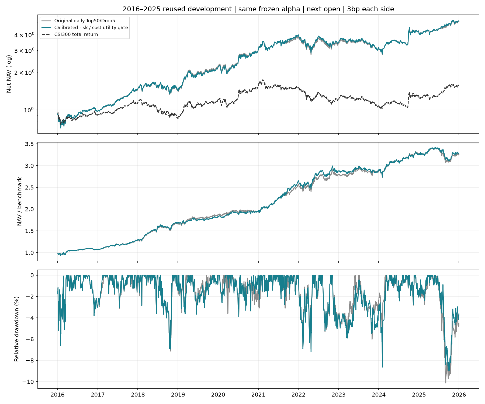
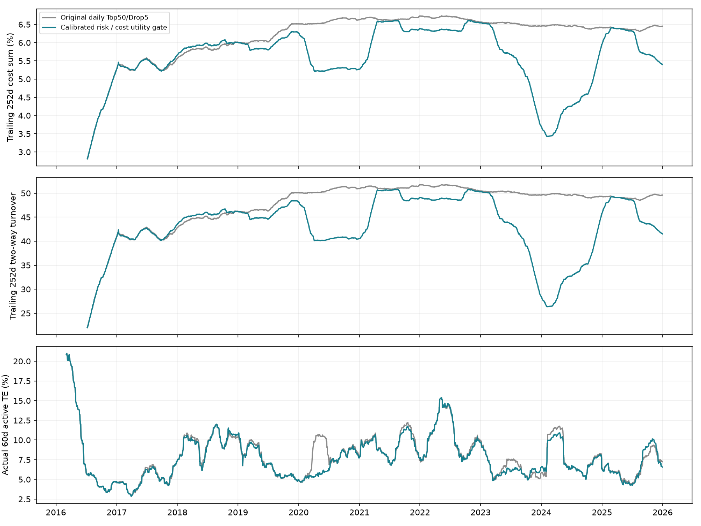

# 五日收益校准与边际净效用换股

**该候选在2016—2025开发回测中同时改善收益、超额IR和最大相对回撤。** 原LightGBM、历史股票池、日频Top50/Drop5候选机制、买入预算、下一日开盘执行及每边3bp滑点保持原样；仅增加换股净收益门槛。没有降低股票总仓位，也没有使用未来未成熟标签。

| 指标 | 原日频模型 | 边际净收益候选 |
| --- | ---: | ---: |
| 平均年度超额IR | 1.550 | 1.579 |
| 全期超额IR | 1.519 | 1.561 |
| 年化收益 | 17.69% | 17.82% |
| 最大相对回撤 | -10.13% | -8.96% |
| 最大绝对回撤 | -28.71% | -30.00% |
| 实现跟踪误差 | 8.48% | 8.29% |
| 平均股票仓位 | 99.49% | 99.55% |
| 年均双边换手 | 46.58 | 42.02 |



## 一、为什么这次保留原选股机制

此前周频风险预算优化同时改变了选股实现、频率和候选准入，未通过整体检验。本轮保留原模型每次最多替换5只股票的机制，只决定一笔候选换股是否值得支付成本。关闭门槛的完整账户已与原发布账户逐日复现一致。

原规则可能在预测分数差很小时仍然换仓。分数不是收益单位，因此先用过去已成熟的样本校准“分数差对应多少五日收益差”，再与费用和滑点比较。该方法借鉴[Boyd等的交易成本与风险统一决策框架](https://web.stanford.edu/~boyd/papers/cvx_portfolio.html)，是原候选换股集上的局部净收益选择，不宣称全市场全局最优。

## 二、从分数到可比较的收益单位

每日将当期股票分数横截面标准化为z。标签为次日开盘至第六日开盘的五日股票收益，去除该信号日股票横截面均值。逐日用带截距OLS估计该标签对z的斜率；每天至少100对有效样本。

信号日t只使用退出开盘已经发生、退出日≤t的历史标签。对最近126个有效斜率按60日半衰期加权，得到非负均值系数；至少60个成熟信号日后才启用门槛，之前完全使用原规则。也记录HAC五阶标准误作为估计不确定性，最终候选不额外扣除一倍标准误。

```text
预期五日换股收益差 = max(0, 历史加权斜率均值) × (z新股票 − z旧股票)
换股成本门槛 = 卖出费用 + 买入费用 + 两边滑点
主动风险扣减 = (风险厌恶4 / 2) × 5 × 换股引起的日主动方差变化 / 被替换持仓权重
普通候选换股仅在：预期收益差 − 成本门槛 − 主动风险扣减 > 0 时执行
```

通常费用为卖出15bp、买入5bp，两边滑点合计6bp，共26bp；最低5元费用按旧持仓计划价值折算。预测成本是计划近似，真实费用仍逐笔扣除，滑点进入成交价而不重复收费。退出股票池、修正持仓数量等必要处置单独记录，已有空缺席位仍按原规则补齐。

## 三、成本、风险与全部方法比较



| 方案 | 平均年度超额IR | CAGR | 最大相对回撤 |
| --- | ---: | ---: | ---: |
| 原规则精确重放 | 1.550 | 17.69% | -10.13% |
| 一倍标准误折减＋净收益门槛 | 1.565 | 17.05% | -8.82% |
| 历史均值＋净收益门槛 | 1.617 | 18.13% | -9.74% |
| 一倍标准误折减＋风险扣减 | 1.528 | 16.36% | -7.65% |
| 历史均值＋风险扣减（选中） | 1.579 | 17.82% | -8.96% |

风险扣减使用未收缩基准beta的条件单市场＋对角残余模型，比较换股前后五日主动方差，风险厌恶系数固定4。它假设残余独立，会遗漏行业共振；最终版本启用该连续风险扣减，未启用前一失败候选的10%TE或beta硬约束。降低风险的换股可以得到正向效用，不等于无条件减少股票仓位。在同时达到基线收益、两类IR和相对回撤要求的版本中，选择最大相对回撤最小的一组；全部变体仍披露。

## 四、检查与不确定性

- 独立重算20个横截面原始开盘收益斜率，以及25个滚动校准点。所有可用标签的退出日期不晚于信号日。
- 已核对门槛效用计算、接受/拒绝、成熟时点、与原规则完全相同的预热期、逐笔费用/滑点、现金、量额容量和数量账簿。
- 新账户2,430天独立账簿最大金额差异为0.000000358元。
- 全期IR差值为+0.042；20日配对圆形块Bootstrap、4,999次的描述性95%区间为[-0.123, +0.218]。

改进幅度有限，区间若覆盖零不能声称统计显著。四个门槛变体及此前风险预算试验都使用了开发区间，存在选择偏差，Bootstrap没有校正这些选择；尚未获得独立样本外证明。没有未来未成熟标签，不等于没有过拟合风险。

原Qlib复权单位账簿、同次执行先卖后买、9.5%简化方向限制和前20日量额5%容量代理继续保留；没有重放集合竞价冻结资金、订单队列或动态冲击。基准仍为H00300全收益，首日开盘采用原实验的近似，所有比较保持同口径。

## 五、复现

```bash
python -m src.marginal_risk_gate --data-dir /path/to/qlib_data --output runs/marginal-gate
python -m src.marginal_gate_report --data-dir /path/to/qlib_data --source runs/marginal-gate --output runs/marginal-gate-report
```

保存的account为选中候选的完整账户，原模型及原账户继续保留。模拟盘未自动切换。
