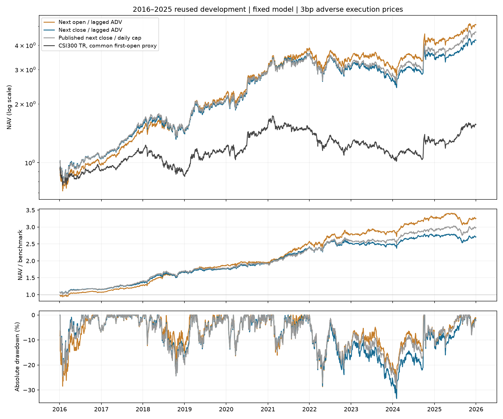

# 冻结预测：t+1开盘执行对照

模型、原五日收盘标签和固定预测不变，不重训；换仓的卖出与买入都移到同一执行时点。每边3bp滑点、买入5bp/卖出15bp、最低5元。

| 执行方案 | 平均年度超额IR | 全期超额IR | 年化收益 | 最大绝对回撤 | 平均股票敞口 |
| --- | ---: | ---: | ---: | ---: | ---: |
| 下一日开盘 / 前日已知量额容量 | 1.550 | 1.519 | 17.69% | -28.71% | 99.49% |
| 下一日收盘 / 前日已知量额容量 | 1.280 | 1.267 | 15.55% | -33.44% | 99.45% |
| 原收盘账户 / 原全天量额容量 | 1.420 | 1.383 | 16.66% | -29.47% | 99.31% |



## 实验口径

- 两个新账户均使用上一交易日已完成的20日平均成交量、成交额的5%作容量代理。它不是开盘竞价可用量，也不是容量保证。
- 开盘方向限制基于开盘价相对前收盘，不使用当日收盘涨跌幅；统一9.5%只是简化限制。
- 不以当日高低价或全天量额决定开盘成交；开盘×1.0003/0.9997作为不利执行价代理，没有模拟盘口冲击和竞价队列。
- 日终仍按收盘价估值；计划数量继续按上一收盘制定，现金不足和整手会缩量。全额卖出保留完整复权持仓，避免留下不可卖的小额尾仓。
- 仍沿用模拟器先卖后买、同次执行资金可再用的顺序假设，尚未证明真实同一次集合竞价的资金冻结可实现。
- 所有表中行统一以首日开盘为基准投入时点；缺少官方H00300开盘点位，首日收益由SH000300开收盘比率近似，之后使用H00300全收益收盘序列。首日是基准近似。
- 因首日基准投入时点不同，表内原收盘账户IR不会等于既有报告的1.378/1.344；既有账户净值、CAGR和回撤不变。原报告继续保留。
- 原收盘账户还使用全天量额和高低价条件，因此应优先比较前两行；第三行为历史参考，不能将其差异全部归因于时点。
- 2016—2025为反复使用的开发区间；这是原标签模型的执行敏感性实验，不是针对开盘持有期重新训练的最优模型。

## 逐年与首日敏感性

- 开盘版的年度超额IR在10年中有8年高于同口径收盘版；2016、2020年较低，2025年仍为负。
- 排除首个交易日后，开盘/收盘的平均年度IR分别为1.566 / 1.239，优势仍在。该项仅为敏感性分析，2016年少了首日，不替代主表十年完整账户。

## 核查

现金、费用、参考成交价、容量和信号时序核对通过；独立累计买卖数量、按收盘估值加现金，重建2,430日账户，最大误差小于0.000001元。详见`checks.json`和`independent_account_audit.json`。

## 复现

```bash
python -m src.open_execution --data-dir /path/to/qlib_data --output results/next_open_3bp
python -m src.open_report --data-dir /path/to/qlib_data --output results/next_open_3bp/report
```

新输出目录必须不存在。该独立模块不刷新原发布manifest，也不覆盖原模型、预测或账户。

从保存账户复算报告（需要行情中的首日指数开收盘数据）：

```bash
python -m src.open_report --data-dir /path/to/qlib_data --output runs/open-report
python -m src.open_audit --data-dir /path/to/qlib_data
```
