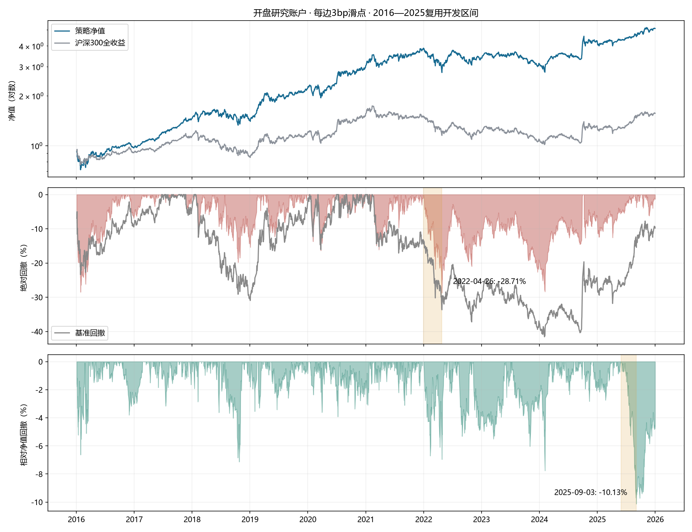
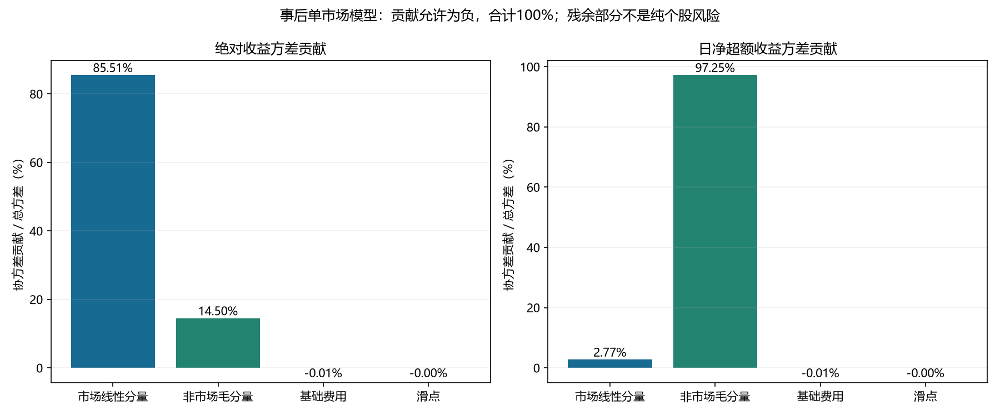
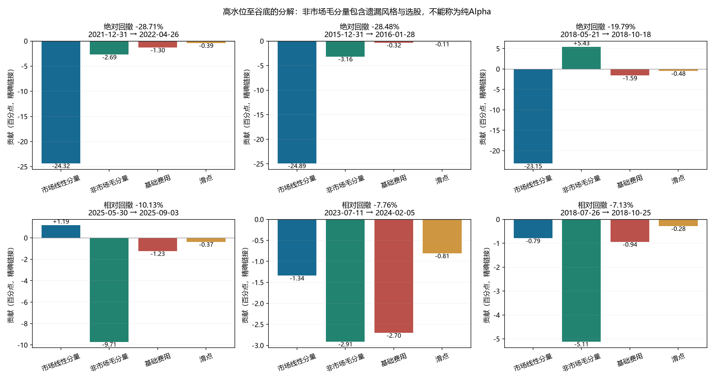
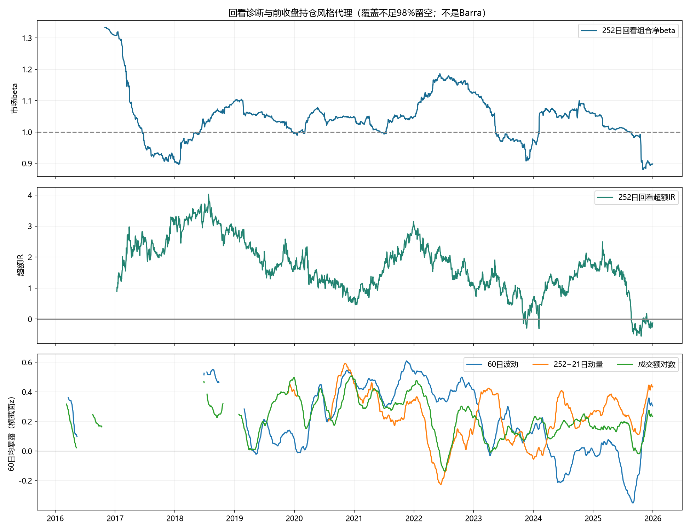

# 风险归因与回撤分析

分析对象为冻结LightGBM的 **t+1开盘、每边3bp滑点研究账户**，2016-01-04至2025-12-31，2,430个交易日。原模型、预测、持仓路径与执行参数均未改动。模拟盘另有竞价前现金预算约束，不直接继承本报告结果。

## 分析结论

- 平均股票敞口99.49%，净收益事后市场beta约1.075。市场残差预测目标并不使多头组合市场中性。
- 排除首个建仓/基准近似日，年化净波动21.92%，跟踪误差8.47%，组合与基准日收益相关系数0.925。
- 年均双边换手46.58倍；基础费用和滑点的日占比年均加总为4.66%、1.40%。这是实际路径成本归因，不是扣减CAGR或无成本策略重跑。
- 平均有效持仓数48.1，平均最大单股权重2.76%，全期最大单股权重4.58%。Top50并不等于每天严格2%等权。

## 主要回撤区间

| 类型 | 高水位 | 谷底 | 回撤 | 同期策略收益 | 同期基准收益 | 恢复高水位 |
| --- | --- | --- | ---: | ---: | ---: | --- |
| 绝对净值 | 2021-12-31 | 2022-04-26 | -28.71% | -28.71% | -23.38% | 2024-09-30 |
| 绝对净值 | 2015-12-31 | 2016-01-28 | -28.48% | -28.48% | -23.40% | 2016-10-20 |
| 绝对净值 | 2018-05-21 | 2018-10-18 | -19.79% | -19.79% | -20.78% | 2019-02-18 |
| 相对净值 | 2025-05-30 | 2025-09-03 | -10.13% | 6.13% | 18.09% | 截至2025-12-31未恢复 |
| 相对净值 | 2023-07-11 | 2024-02-05 | -7.76% | -22.81% | -16.32% | 2024-03-06 |
| 相对净值 | 2018-07-26 | 2018-10-25 | -7.13% | -15.77% | -9.30% | 2018-11-13 |

恢复日期是谷底之后首次达到该次高水位的日期；不是“谷底至恢复”的独立收益。初始资金净值1作为首个高水位。区间高水位当日不计入损益，计算从下一交易日开始。



## 事后风险归因

采用单市场事后描述性模型：`gross_t = beta_gross × benchmark_t + nonmarket_gross_t`；再扣基础费用和滑点，精确得到账户净收益。beta为全期排除首日的带截距OLS斜率，截距保留在非市场毛分量，不是事前预测。非市场毛分量同时包含行业/风格遗漏、个股选择、现金和交易路径，不能称为纯Alpha或Barra特质收益。

`variance_share_k = Cov(component_k, total_return) / Var(total_return)`；贡献可为负，合计100%。超额归因使用`(beta_gross−1)×benchmark_t`、同一非市场毛分量及成本。

| 分量 | 绝对收益方差占比 | 日净超额收益方差占比 |
| --- | ---: | ---: |
| 市场线性分量 | 85.51% | 2.77% |
| 非市场毛分量 | 14.50% | 97.25% |
| 基础费用 | -0.01% | -0.01% |
| 滑点 | -0.00% | -0.00% |

方差表排除初始建仓日，以免首日基准开盘近似和建仓边界主导诊断；包含首日的敏感性结果也保存在CSV。它们不改变已有回测评价口径。



## 回撤损益贡献

下表将每日分量按“前一日资产/回撤起点资产”链接，合计精确等于峰谷回撤。相对回撤先将每日分量转为相对净值收益：`(r_p−r_b)/(1+r_b)`，再按相对净值链接。百分比是回撤百分点，不是人民币亏损或简单日收益加总。

| 类型及谷底 | 市场线性分量 | 非市场毛分量 | 基础费用 | 滑点 | 合计 |
| --- | ---: | ---: | ---: | ---: | ---: |
| 绝对 2022-04-26 | -24.32% | -2.69% | -1.30% | -0.39% | -28.71% |
| 绝对 2016-01-28 | -24.89% | -3.16% | -0.32% | -0.11% | -28.48% |
| 绝对 2018-10-18 | -23.15% | +5.43% | -1.59% | -0.48% | -19.79% |
| 相对 2025-09-03 | +1.19% | -9.71% | -1.23% | -0.37% | -10.13% |
| 相对 2024-02-05 | -1.34% | -2.91% | -2.70% | -0.81% | -7.76% |
| 相对 2018-10-25 | -0.79% | -5.11% | -0.94% | -0.28% | -7.13% |



## 重点区间：为什么会回撤

**2022年绝对回撤：市场下跌叠加主动分量与成本拖累。** 2021-12-31至2022-04-26，基准下跌23.38%，策略下跌28.71%。固定beta分解中，市场分量-24.32个百分点，非市场毛分量-2.69个百分点，基础费用与滑点合计-1.69个百分点。该阶段既有系统性下跌，也有相对落后，不能只说“熊市拖累”。

**2025年相对回撤：组合上涨，但没有跟上基准。** 2025-05-30至2025-09-03，策略上涨6.13%，基准上涨18.09%；相对净值回撤-10.13%，不是亏损10.13%。该阶段实际毛收益回归beta约0.696，前收盘持仓beta代理均值0.773。用十年固定beta解释短期会把beta变化混进非市场分量。

该区间67天的前收盘beta代理全部达到98%覆盖要求。补充时变beta代理归因：低于基准的市场敏感度贡献-3.25个百分点，非市场毛分量-5.28个百分点，基础费用-1.23、滑点-0.37个百分点，合计-10.13个百分点。因此，低beta未跟上上涨只能解释部分落后，其余仍需检查个股/遗漏风格与成本。

此处beta原始估计来自SH000300价格指数，收益归因使用H00300全收益基准，属于基准近似的代理分解；前收盘持仓也不等于开盘换仓后的全天风险。不同归因模型的划分可以不同，不能将该残余当成纯选股原因。

**2025年全年：毛优势被成本覆盖。** 在相同已成交路径上，日毛超额均值×252为5.72%，基础费和滑点日均×252合计6.45%，净超额日均×252变为-0.73%。这个恒等式说明成本是全年净超额转负的直接账面因素；不表示实际取消费用后仍能保持同一持仓路径。

## 前收盘风险暴露与模型诊断

| 区间谷底 | beta代理均值 | 波动z | 动量z | 流动性z | 区间内已成熟RankIC | beta覆盖有效日/区间日数 |
| --- | ---: | ---: | ---: | ---: | ---: | --- |
| 2022-04-26 | 1.119 | 0.426 | -0.010 | 0.215 | 0.036 | 73/74 |
| 2016-01-28 | 1.308 | 0.728 | 缺失 | 0.467 | 0.118 | 18/19 |
| 2025-09-03 | 0.773 | -0.351 | 0.140 | 0.037 | 0.011 | 67/67 |
| 2024-02-05 | 0.887 | 0.135 | 0.062 | 0.162 | 0.004 | 141/142 |

z为相对当日等权历史成员的暴露，不是相对真实指数权重；均值只取覆盖达标日，其他风格各自覆盖天数见CSV。RankIC仅纳入t+6退出日不晚于谷底的已成熟标签，预测仍针对原五日收盘残差目标，不等同实际开盘交易收益。不同阶段IC差异是诊断线索，没有进行因果或显著性断言。

## 回撤原因与证据边界

1. **市场风险与主动风险不同。** 接近满仓的多头指增在系统性下跌中仍会亏损；同时跑赢下跌的基准不代表没有绝对回撤。峰谷期间的基准收益和市场线性分量用于量化这一点。
2. **选股毛优势必须覆盖交易成本。** 年度表同时给出毛收益、净超额、费用和滑点。费用即使波动很小、对方差贡献接近0，仍可持续拖累收益和恢复速度。单市场残余变差不能自动解释为机器学习失效。
3. **持仓并非行业/风格中性。** 前收盘持仓的波动、动量、流动性代理参考当日等权历史沪深300成员做z分数，覆盖不足98%留空；缺少真实历史基准权重，无法把偏离归为具体行业配置效应。
4. **模型时效性需要持续观察。** 2017后模型被冻结；回看beta、超额IR及区间内成熟RankIC用于定位表现变化，但不能由时间先后断言“冻结导致回撤”。本次没有依据回撤区间重新调参。



## 年度执行与收益诊断

| 年度 | 净收益 | 基准收益 | 日净超额均值×252 | 毛收益日均×252 | 基础费日占比加总 | 滑点日占比加总 | 双边换手 |
| --- | ---: | ---: | ---: | ---: | ---: | ---: | ---: |
| 2016 | -2.75% | -9.13% | 9.13% | 7.16% | 4.04% | 1.23% | 40.87倍 |
| 2017 | 49.38% | 24.25% | 19.11% | 47.65% | 4.16% | 1.25% | 41.62倍 |
| 2018 | -1.38% | -23.64% | 27.46% | 7.78% | 4.44% | 1.33% | 44.36倍 |
| 2019 | 55.27% | 39.19% | 11.52% | 54.16% | 4.85% | 1.45% | 48.45倍 |
| 2020 | 36.30% | 29.89% | 5.62% | 41.99% | 4.92% | 1.48% | 49.19倍 |
| 2021 | 27.88% | -3.52% | 29.84% | 34.59% | 5.00% | 1.50% | 49.93倍 |
| 2022 | -13.14% | -19.84% | 9.49% | -4.89% | 4.85% | 1.45% | 48.44倍 |
| 2023 | -6.93% | -9.14% | 2.62% | 0.02% | 4.77% | 1.43% | 47.70倍 |
| 2024 | 35.37% | 18.24% | 14.65% | 40.78% | 4.74% | 1.42% | 47.37倍 |
| 2025 | 20.16% | 20.98% | -0.73% | 26.66% | 4.79% | 1.44% | 47.84倍 |

日均×252是算术年化，不能与复利年度收益直接相减。成本为同一已成交路径的实际费用与成交价差，不是无成本独立账户。

## 个股归因与信息完整性

`stock_net_return_contributions.parquet`保留每只股票每日对组合净收益的贡献；`stock_risk_contributions.csv`为单股与组合净收益的协方差风险贡献；`drawdown_stock_contributions.csv`保留主要峰谷期间全部股票的净损益贡献。个股排名是对组合资产的贡献，没有历史指数个股权重，不能解释为逐股主动Alpha。股票名称可能变更，因此结果以代码为准。

最大绝对回撤区间的主要个股负贡献如下，按区间起点组合资产计；是损益贡献，不是股票自身跌幅：

| 股票代码 | 对组合净收益的贡献 |
| --- | ---: |
| SH601633 | -1.072个百分点 |
| SZ300782 | -0.984个百分点 |
| SZ002624 | -0.872个百分点 |
| SH603501 | -0.859个百分点 |
| SZ300413 | -0.857个百分点 |

上述五只合计-4.64个百分点，占该次净回撤幅度约16.2%；不支持把整次回撤归结为某一只异常股票。该比例为净损失比较，正负贡献会相互抵消，不是风险方差占比。

日损益通过“前收盘持仓的隔夜收益 + 开盘后持仓的日内收益 − 成交价滑点 − 基础费用”重建，并与原账户逐日核对。停牌估值沿用原账户的最近有效价格；没有删除异常股票或改写原始账户。归因保留已声明的复权单位及日线执行局限。

## 复现与核查

无需原始行情，从保存的充分统计量重算归因、表格和四张图：

```bash
python -m src.risk_attribution report --input results/risk_attribution --output runs/risk-report
```

使用原始Qlib缓存重建逐股损益及前收盘暴露：

```bash
python -m src.risk_attribution build --data-dir /path/to/qlib_data --output runs/risk-rebuild
python -m unittest tests.test_risk_attribution
```

新输出目录必须不存在。输入指纹见`provenance.json`；逐日恒等式、协方差加总和峰谷链接均有断言。2016—2025已反复开发使用，本报告提供事后解释，不证明新样本外盈利。尚无完整历史行业、规模/估值暴露、基准权重、风险因子收益、因子协方差和特质风险，因此不是完整Barra事前风险模型，也不是Brinson行业配置/选择归因。

方法参考：[MSCI因子风险数据结构](https://developer.msci.com/apis/factor-analytics)、[CFA多因子模型与主动风险](https://www.cfainstitute.org/insights/professional-learning/refresher-readings/2026/using-multifactor-models)、[Qlib评价实现](https://github.com/microsoft/qlib/blob/main/qlib/contrib/evaluate.py)。本报告具体数值全部来自本项目保存账户。
