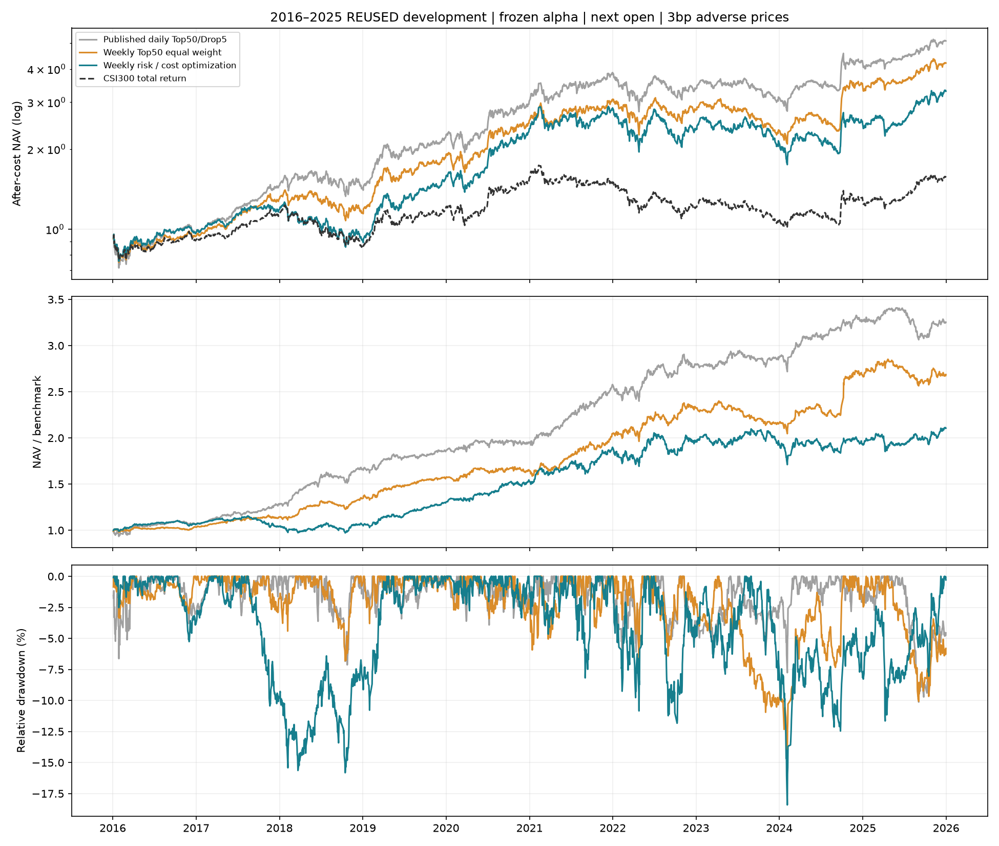
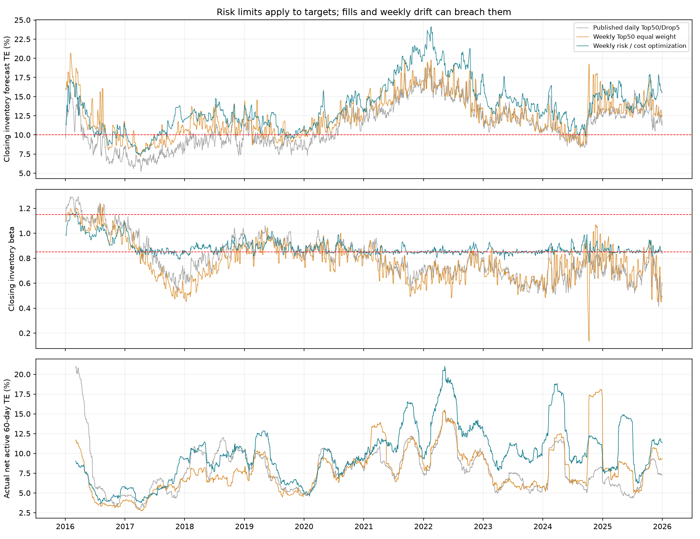

# 组合优化与主动风险管理实验

**本轮结论：未能降低全期最大相对回撤。** 优化组合与原账户的最大相对回撤差为-8.28个百分点，年化收益差为-5.01个百分点，全期超额IR差为-0.676。这些变化同时报告，不仅选取有利窗口。此模块为离线研究风控系统，不自动替换原模型或模拟盘。

2016-01-04—2025-12-31，共2,430个交易日、初始资金1亿元。冻结原LightGBM及预测，次日开盘执行，每边3bp成交价滑点；基准为H00300全收益指数，首日仍沿用原开盘实验的价格指数开收盘比例近似。

## 一、全期账户与成本

| 方案 | 平均年度超额IR | 全期超额IR | CAGR | 最大绝对回撤 | 最大相对回撤 | 实现TE | 平均股票仓位 |
| --- | ---: | ---: | ---: | ---: | ---: | ---: | ---: |
| 原日频Top50/Drop5 | 1.550 | 1.519 | 17.69% | -28.71% | -10.13% | 8.48% | 99.49% |
| 周频Top50等权 | 1.225 | 1.278 | 15.46% | -32.92% | -14.73% | 8.43% | 98.94% |
| 分层信号预算＋风险/成本优化 | 0.904 | 0.843 | 12.68% | -39.55% | -18.41% | 10.38% | 99.06% |



| 方案 | 年均双边换手 | 年均基础费用日占比加总 | 年均滑点日占比加总 |
| --- | ---: | ---: | ---: |
| 原日频Top50/Drop5 | 46.58倍 | 4.66% | 1.40% |
| 周频Top50等权 | 67.64倍 | 6.76% | 2.03% |
| 分层信号预算＋风险/成本优化 | 18.93倍 | 1.89% | 0.57% |

费用占比按每日前净值计算，不直接从CAGR相减。周频完全重选50只股票可能比日频只换5只的账户换手更高；频率低不等于成本低。


## 二、原超额回撤的线索与设计对应

2025-05-30至2025-09-03，原账户上涨6.13%，基准上涨18.09%，相对回撤10.13%。已有精确链接的代理归因显示：市场敏感度偏离−2.90个百分点、价格/全收益基准差−1.64个百分点、波动风格−2.41个百分点、已覆盖股票残余−1.62个百分点、买卖当日日内增量合计−1.04个百分点、基础费用及滑点−1.60个百分点，另有共同项等抵消。它是模型依赖的事后解释，不是因果证明。

因此新设计同时考虑双向beta、总跟踪误差和成本；没有仅在亏损后削减股票仓位。预测和评价统一采用全收益基准。详细账目见[原回撤归因](../../deep_attribution/README.md)。

## 三、独立比较旧回撤窗口

| 原账户选定窗口 | 方案 | 策略区间收益 | 基准区间收益 | 相对区间收益 |
| --- | --- | ---: | ---: | ---: |
| 2025_relative | 原日频Top50/Drop5 | 6.13% | 18.09% | -10.13% |
| 2022_absolute | 原日频Top50/Drop5 | -28.71% | -23.38% | -6.96% |
| 2023_24_relative | 原日频Top50/Drop5 | -22.81% | -16.32% | -7.76% |
| 2025_relative | 周频Top50等权 | 8.68% | 18.09% | -7.97% |
| 2022_absolute | 周频Top50等权 | -26.51% | -23.38% | -4.08% |
| 2023_24_relative | 周频Top50等权 | -26.04% | -16.32% | -11.62% |
| 2025_relative | 分层信号预算＋风险/成本优化 | 21.31% | 18.09% | 2.73% |
| 2022_absolute | 分层信号预算＋风险/成本优化 | -31.68% | -23.38% | -10.84% |
| 2023_24_relative | 分层信号预算＋风险/成本优化 | -28.96% | -16.32% | -15.11% |

这些日期由原策略的事后回撤确定，只用于诊断；优化组合自身峰谷见[完整相对回撤表](relative_drawdown_episodes.csv)，不能将这些窗口当作优化组合的最大回撤。

## 四、风控系统及优先级

- 新买入候选须具备252日完整历史；使用信号日及此前数据，实际旧持仓始终保留在风险账本。
- 完整历史子集用联合收缩协方差；部分历史旧持仓用市场条件扩展；无法估计的持仓使用明确标注的100%年化特质波动准备，尝试退出但保留未成交风险。准备不是损失上界。
- 硬约束：股票目标99%、单股不超过4%、beta在0.85—1.15、每次双边计划换手不超过40%（首次建仓例外），不合格旧持仓不可新增。
- 先计算硬约束下可达到的最高排序暴露。能保留参考Top50排序暴露时保留；不能达到时要求可行前沿并记录参考缺口。排序预算不等于预期收益保证。
- 再权衡参考权重偏离、预测主动方差、线性交易成本和TE预算超出量。10%TE是软预算，超出显式记录，不能用不建仓躲过下跌冒充改进。
- 每周首个交易日按前收盘计划，次日开盘执行。目标低于1bp的数值尾仓编译为完整退出/不新买；实际成交仍受整手、费用、现金和前20日量额容量限制。
- 收盘基于实际持仓、同一类候选风险宇宙重新估计TE/beta；逐日生成风险快照、市场±10%与波动1.5倍情景、相对回撤−6%预警/−8%升级记录。预警不触发额外事后择时交易，自动交易响应仍按周执行。



## 五、风险估计与校准的边界

| 方案 | TE超预算天数 | beta超限天数 | 无法估计风险持仓天数 | 最大准备项股票权重 | 可验证历史VaR天数 | VaR95突破率 |
| --- | ---: | ---: | ---: | ---: | ---: | ---: |
| 原日频Top50/Drop5 | 1441 | 1676 | 407 | 5.90% | 1489 | 5.78% |
| 周频Top50等权 | 1984 | 1772 | 7 | 2.11% | 1739 | 4.77% |
| 分层信号预算＋风险/成本优化 | 2200 | 737 | 0 | 0.00% | 1803 | 5.21% |

TE/beta目标约束与收盘实际持仓不同；跳空、未成交、价格漂移和每周复核间隔均可能导致实际超限。10%是预算，不能声称实际TE永不超过10%。

VaR检验使用收盘后冻结该库存的下一日假想主动收益，不计下一日换仓和费用；实际账户的净60日TE另画。共同历史不足或未来单股收益缺失的日期不参加VaR检验；准备项有风险估计不等于有可验证VaR。有效天数少时突破率不能证明风险模型可靠。

Euler证券/基准风险贡献精确加总到预测TE²，但含负基准项，不是完整Barra行业/风格归因，也没有证实行业中性。历史波动和VaR不能保证未来最大回撤。

## 六、实现核对与统计不确定性

| 实验账户 | 成功目标 | 跳过调仓 | 最大独立账簿差异（元） |
| --- | ---: | ---: | ---: |
| 周频Top50等权 | 511 | 0 | 0.000000238 |
| 分层信号预算＋风险/成本优化 | 500 | 11 | 0.000000238 |

每次跳过的原因保存在checks.json和decisions.csv。已核对逐笔价格、费用、现金、容量、信号前一交易日、数量账簿、非负持仓、目标约束和风险贡献加总。

| 全期IR差值 | 点估计 | 配对块Bootstrap描述性95%区间 |
| --- | ---: | --- |
| optimized minus published_daily | -0.676 | [-1.286, -0.057] |
| optimized minus weekly_equal | -0.436 | [-1.040, +0.184] |

固定20日圆形块、4,999次、种子20261103。该区间不能校正整个项目的策略选择。规则经过开发期可用性、可行性和信号损失反馈后修订；没有参数网格搜索不等于没有过拟合风险。2016—2020和2021—2025拆分结果均是开发子区间，见era_comparison.csv。

## 七、方法来源与复现

单期风险/成本决策参考[Boyd等，Multi-Period Trading via Convex Optimization](https://web.stanford.edu/~boyd/papers/cvx_portfolio.html)；协方差收缩参考[Ledoit与Wolf](https://ledoit.net/honey_abstract.htm)，实现采用[scikit-learn缩放单位阵目标](https://scikit-learn.org/stable/modules/generated/sklearn.covariance.LedoitWolf.html)。这是借鉴方法，没有复现原论文的全部实证或MSCI商业Barra模型。

完整数学、缺失风险、约束冲突、执行与岗位讨论见[组合优化与风险管理](../../../docs/组合优化与风险管理.md)。

```bash
pip install -r requirements-risk.txt
python -m src.active_risk_system --data-dir /path/to/qlib_data --historical-benchmark results/risk_management/official_benchmark_history.json --output runs/risk-replay
python -m src.active_risk_report --data-dir /path/to/qlib_data --source runs/risk-replay --output runs/risk-replay/report
```

原始股票行情仍需另备。报告复算使用保存的收益风险输入，并通过原始行情独立重建数量账簿；未重放盘口、集合竞价资金冻结和动态冲击。历史风险数据本身也不是逐时点供应商快照。原模型和原发布账户没有被本实验覆盖。
