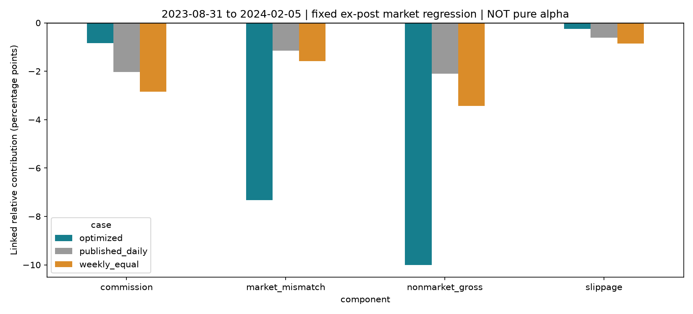

# 风控实验复盘：为何局部有效，整体没有通过

该候选未替换原策略。2025旧回撤窗口虽改善，但候选自身最深相对回撤为-18.41%，峰谷是2023-08-31至2024-02-05，恢复日期为2025-12-09。原策略十年最大相对回撤为10.13%。

## 一、成本节约补不回毛超额流失

| 方案 | 年化算术毛超额均值 | 年化算术成本 | 年化算术净超额均值 |
| --- | ---: | ---: | ---: |
| 原日频模型 | 19.15% | 6.28% | 12.88% |
| 周频等权 | 19.89% | 9.12% | 10.77% |
| 分层风控候选 | 11.30% | 2.55% | 8.75% |

这是日均值×252的同口径加减，不是CAGR分解。毛超额指在已成交数量路径上加回费用/滑点的会计分量，不是可独立交易的无成本账户。

## 二、新最大回撤发生在另一个阶段

| 同一固定窗口 | 相对收益 | 区间毛收益描述性beta |
| --- | ---: | ---: |
| 原日频模型 | -5.89% | 1.070 |
| 周频等权 | -8.72% | 1.099 |
| 分层风控候选 | -18.41% | 1.466 |

候选在该段的精确链接贡献为：市场敏感度偏离-7.32个百分点、非市场毛分量-10.01个百分点、基础费用-0.83个百分点、滑点-0.25个百分点；合计-18.41个百分点。原模型相同窗口分别为-1.15、-2.09、-2.04、-0.61个百分点。

该窗口成功发布目标的模型beta均值为0.850，与事后实现的区间beta不是同一统计量。目标约束、每周复核、成交偏差及风险估计误差共同构成局限；这里不能只凭一个beta差值归因于某一项。

将毛收益对同一窗口的全收益基准做事后单市场回归，拆成市场偏离、非市场毛分量、基础费用和滑点，再按相对净值精确链接。贡献合计对应各账户相同窗口相对收益。beta使用整个诊断窗口估计，仅用于事后解释，没有进入交易。非市场包含遗漏风格、行业、个股、交易路径和数据影响，不能叫纯选股Alpha。

## 三、约束冲突挤占了组合选择空间

- 共500次发布目标、11次跳过；跳过时保留真实持仓。
- 491次在硬约束下不能达到Top50参考排序暴露；只能执行已记录的可行前沿，不能声称实际保留全部信号。
- 456次目标仍超过10%软TE预算。预算优先级和可行性限制意味着不能宣传成严格10%TE控制。
- 非初始目标中，499次触及40%双边换手上限。换手约束、beta范围和参考排序预算存在明显冲突。

这组证据支持“组合约束改变了原信号的实现、成本节约不足以抵消毛超额流失”，但不能分别证明某一个约束是唯一原因。要识别单项作用，需要另设预注册消融实验；本轮没有继续追逐开发期最优参数。

## 四、保留哪些成果，暂不采用哪些规则

保留实际持仓风险快照、数据缺口准备、订单账簿审计、可行性检查、成本拆分和报警记录。原日频模型继续作为当前研究基线，分层优化不自动进入模拟盘。

下一步值得验证的假设包括：保持原Top50/Drop5信号形成机制以隔离组合层改动；使用过去已成熟样本校准分数的预期收益单位；对约束做独立消融并校准风险预测。它们是后续研究问题，不是本轮已实现的能力，也不能保证提高IR或降低回撤。
