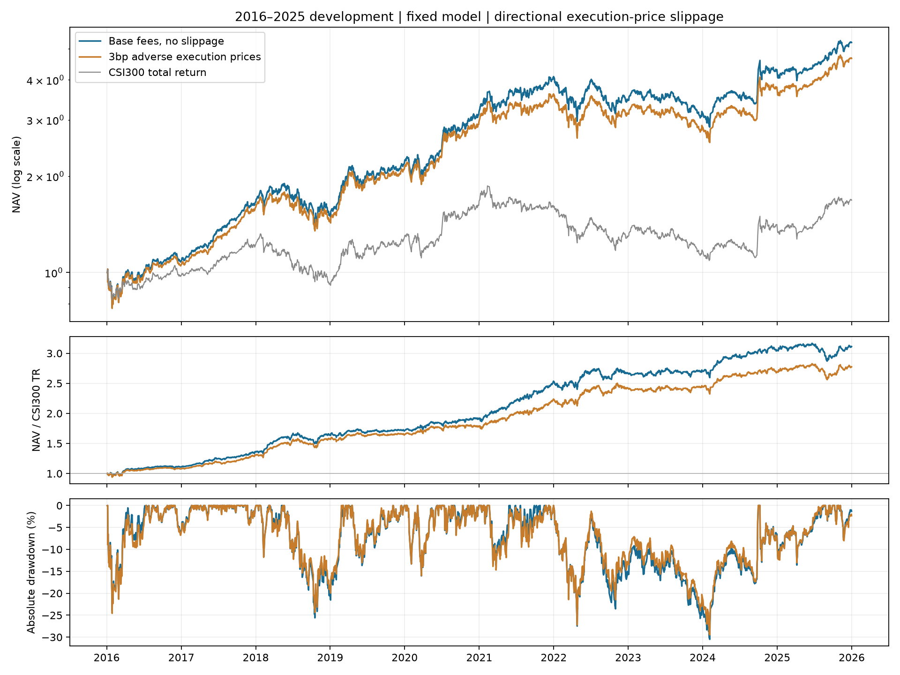

# 独立实验：买卖每边3bp成交价滑点

**原基线平均年度超额IR 1.532没有加入滑点。** 本实验直接修改执行价格，重新重放完整账户；不是在原价成交后加收费用。

| 情形 | 平均年度超额IR | 全期超额IR | 十年年化 | 最大绝对回撤 | 最大相对回撤 |
| --- | ---: | ---: | ---: | ---: | ---: |
| 基础费用、无滑点 | 1.532 | 1.489 | 18.01% | -30.50% | -10.62% |
| 每边3bp成交价滑点 | 1.378 | 1.344 | 16.66% | -29.47% | -9.58% |



## 固定规则

- 买入价=次日复权收盘价×1.0003；卖出价=次日复权收盘价×0.9997。
- 原有买入0.05%、卖出0.15%、每笔最低5元，在滑点后的实际成交金额上计算。
- 股票日终估值仍用原收盘价；滑点损失已经进入交易盈亏，不再作为额外费用扣一次。
- 滑后价格若超出该日高低价区间，则拒绝成交；成交量和实际成交额均受原5%容量约束。
- 本轮有460条价格越界拒单，成交路径随之改变；回撤较低不代表滑点能改善策略。
- 模型、预测、选股与持仓规则不改；滑点引起的现金与成交数量变化会进入后续账户。
- 2016—2025共2430个交易日，同首日投入的H00300全收益基准；这是开发期研究。
- 固定日线滑点仍是简化执行模型，不等于盘口和收盘竞价重放，也没有按订单规模估计动态冲击。

## 重新模拟（需要股票行情）

```bash
python run.py slippage --data-dir /path/to/qlib_data --output runs/slippage3bp
```

## 重算保存实验（无需股票行情）

```bash
python run.py slippage-report --output runs/slippage-report
```

`slippage_orders.parquet`含参考收盘、实际成交价、基础费用和滑点损失归因；`price_rejections.csv`保留价格越界拒单，`experiment.json`和`checks.json`记录方案及核查。
