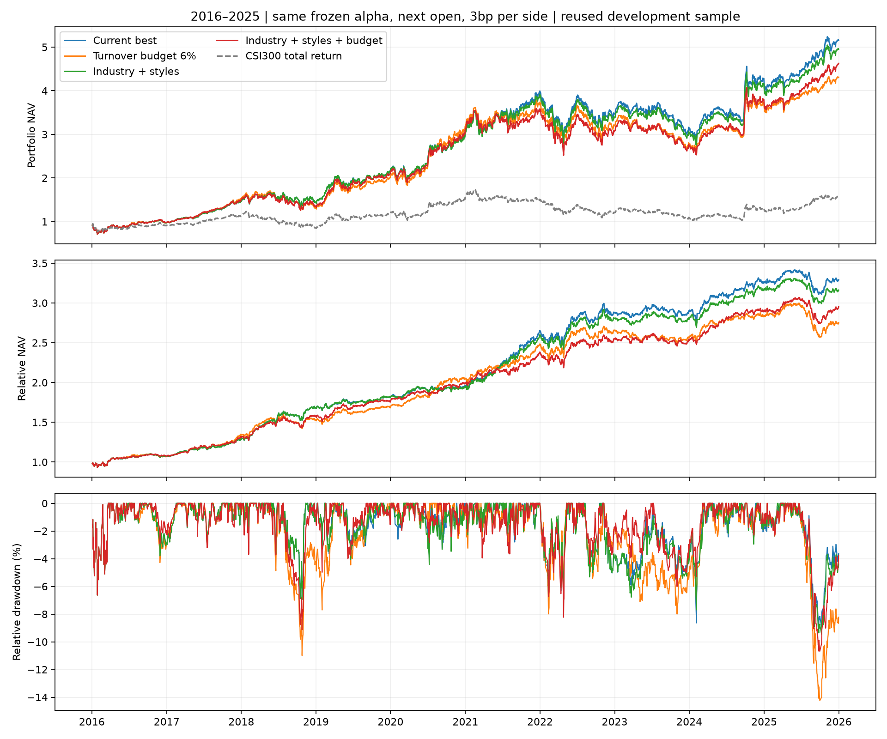
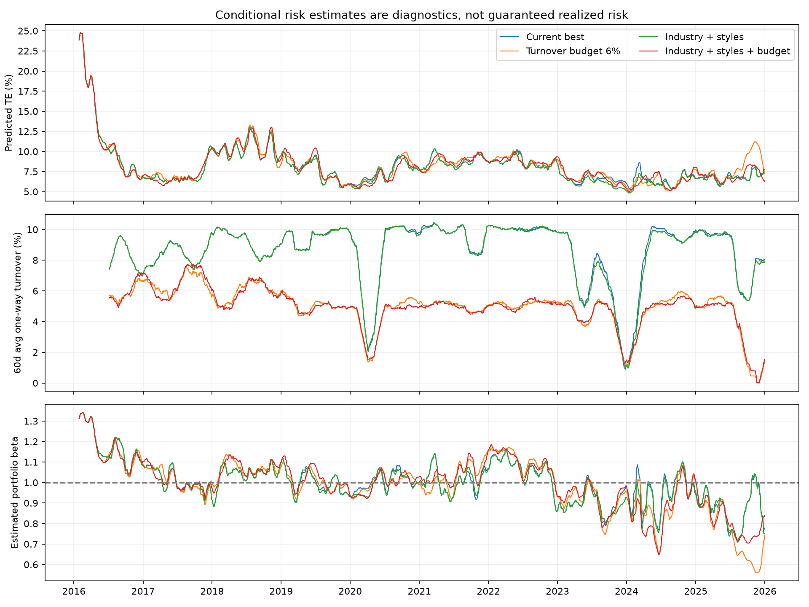

# 行业与量价风格风险模型、换手预算实验

**三组新方法均未同时改善收益、超额IR和最大相对回撤，继续保留原来的边际净效用模型。**

统一使用2016—2025、2,430个交易日、原冻结Alpha158/LightGBM预测、日频Top50/Drop5候选、下一日开盘成交、每边3bp滑点及原基础费用。比较基线是上一轮保留的`risk_net_edge_mean`，并非更早的收盘模型。模拟盘没有切换。

## 十年结果

| 方案 | 平均年度超额IR | 全期超额IR | CAGR | 最大相对回撤 | 最大绝对回撤 | 年均双边换手 | 平均股票仓位 |
| --- | ---: | ---: | ---: | ---: | ---: | ---: | ---: |
| 当前最优：单市场风险＋净效用门槛 | 1.579 | 1.561 | 17.82% | -8.96% | -30.00% | 42.02 | 99.55% |
| 新增6%计划换手预算 | 1.455 | 1.330 | 15.73% | -14.24% | -32.04% | 24.82 | 99.75% |
| 新增行业＋量价风格风险 | 1.537 | 1.527 | 17.35% | -9.48% | -29.60% | 41.80 | 99.56% |
| 行业风格风险＋6%预算 | 1.544 | 1.438 | 16.55% | -10.68% | -29.84% | 24.70 | 99.74% |



IR均以日净策略收益减H00300全收益指数收益计算；平均年度IR为十个自然年度IR的算术平均，全期IR使用全期日序列。相对净值为策略净值/基准净值，相对回撤由该比值的历史高点计算。CAGR按十个日历年复利计算。换手为实际买卖金额之和/前日净值，再将十年总和除以10；单边口径为其一半。

## 风险模型的结构

原候选只用市场beta和个股残差方差，无法显式刻画同行业或相似风格的共同波动。本轮增加一个免费数据可实现的条件行业—风格风险模型：

```text
r(i,t) ≈ beta(i,t−1) × 沪深300全收益(t)
         + 动量/波动/成交额暴露(i,t−1) × 风格收益(t)
         + 行业哑变量(i,t−1) × 行业残余收益(t) + 特质残差(i,t)
主动暴露 a = Σ w(i) X(i) − [1,0,...,0]
预测日主动方差 V = aᵀ F a + Σ w(i)² D(i)
```

它采用Barra式的“暴露—横截面因子收益—协方差—特质风险”结构，但**不是MSCI官方Barra，也不是完整CNE5复刻**。当前不具备完整历史市值、财务描述子和指数权重，因此没有编造Size、价值、成长、杠杆或真实指数行业权重；模型中的基准是直接观测的沪深300收益因子，暴露严格设为[1,0,…]。行业列描述的是给定市场收益后的残余风险，不能解释成相对真实指数持仓的行业超配比例。

| 输入或估计 | 固定定义 |
| --- | --- |
| 历史成员 | Qlib历史沪深300成分区间，逐日取当时成员 |
| 行业 | 免费月末归档；仅取snapshot_date≤信号日的记录；证监会大类A—S；旧社会服务业单列LEGACY_SOCIAL，缺失为UNKNOWN |
| 动量 | close(t−21)/close(t−126)−1，跳过最近21日 |
| 波动 | 最近60日收盘收益标准差，至少40个有效观测 |
| 交易活跃度 | 最近20日成交额均值取对数，至少15个观测；不冒充真实流通股换手率 |
| 标准化 | 当时成员中有数据的股票，5MAD截尾后等权去均值、除标准差 |
| beta | 原条件单市场模型：252日、60日半衰期，至少126对；不足回退1 |
| 因子收益 | 当日收益先扣前日beta×当日基准收益，再对前日行业与风格暴露作等权横截面回归；ridge1e−4仅稳定稀疏列 |
| 因子协方差 | 最近252日、60日半衰期EW；10%向自身对角阵收缩，保留各因子方差、缩小交叉协方差；至少126个拟合日 |
| 特质方差 | 对相应滞后暴露回归后的残差，以252日、60日半衰期估计；至少60个有效值；不足或风格未知使用100%年化特质波动储备 |

风险拟合从2014年启动，为2016年交易准备历史。缺失风格的计算占位为0，同时标记未知并使用高特质风险储备；不是断言其真实风格中性。`risk_monitor.csv`逐日记录未知风格持仓权重。行业采用大类，因此制造业内部的医药、电子、机械共振仍可能遗漏；没有声称满足行业中性约束。

每个收益日t只使用t−1暴露拟合；t收盘后，协方差和个股风险只汇总截至t的已发生数据，供t+1计划使用。收盘收益协方差用于近似五日开盘交易风险，是模型假设，不是精确的开盘跳空风险模型。

## 风控怎样进入交易

Alpha模型与分数校准保持不变，最近126个已成熟五日开盘收益斜率按60日半衰期加权，至少60个成熟日才启用净效用门槛。校准必须等到标签退出开盘发生，不以未成熟未来收益做当前决策。

```text
普通换股效用 = 校准五日收益差 − 预计卖买费用及两边滑点
             − (4/2) × 5 × 换股导致的日主动方差变化 / 被替换持仓权重
```

行业风格版本只将主动方差计算从单市场＋残差改为上述多因子模型；原风险厌恶4、五日尺度、成本规则不变。比较换股时暂设新股接替旧股的权重，真实订单仍按原现金与预算规则生成。这是原候选换股集上的局部净效用选择，既非全股票池全局权重最优，也未增加“行业偏离≤某值”一类硬约束。

## 换手预算怎样执行

```text
计划单边换手 = 0.5 × Σ |订单股数 × 前日收盘价| / 前日净值 ≤ 6%
```

50只股票等权附近，每只约2%，6%预算大致对应3对换股，低于原Drop5最多5对的名义上限。该数值在本轮比较前固定，没有围绕结果搜索最优阈值。沿原候选顺序通过净效用门槛后，如果计划金额超预算，依次撤回最后获准的一对卖旧买新，重新计算买单预算，直到满足约束。不会只撤掉买单而留下可选卖单，也不将预测收益很小的交易强行塞进预算。

**这是一条计划金额约束，实际开盘金额不是精确硬上限。** t收盘时不能预知t+1开盘价；跳空、部分成交、卖出受阻、买入资金缩减等会使实际换手偏离计划。`turnover_budget_audit.csv`同时保留计划和实际单边换手，供逐日核对。

例外为最初建仓、校准预热期、真正退出股票池或纯卖出修正，以及删除所有可选换股后仍需补齐的空缺席位。必要退出当日整体豁免预算，可能含其他换股，因此不能声称每个交易日都满足6%。持仓超过50只但仍是成对换股时，不再作为预算豁免理由。初稿对此豁免过宽，已更正并重新回测两组预算方案；这属于执行逻辑修正，没有改6%或风险系数。



## 成本与机会成本

| 方案 | 年均基础费用/净值之和 | 年均滑点损耗/净值之和 | 实现跟踪误差 |
| --- | ---: | ---: | ---: |
| 当前最优：单市场风险＋净效用门槛 | 4.20% | 1.26% | 8.29% |
| 新增6%计划换手预算 | 2.48% | 0.74% | 8.28% |
| 新增行业＋量价风格风险 | 4.18% | 1.25% | 8.18% |
| 行业风格风险＋6%预算 | 2.47% | 0.74% | 8.17% |

费用和滑点为逐日占净值比例的算术和除以10，不是对CAGR差异的直接加减分解。节约费用可能被延迟换股的毛收益损失抵消；风险模型更复杂也可能因估计误差过滤掉有效交易。只有收益、净超额IR和相对回撤一起比较，才知道这项控制是否值得采用。

### 为什么少交易没有换来更低回撤

以252×日均值计算，当前模型年化算术毛超额为18.60%、交易成本拖累5.66%、净超额12.94%；6%预算版本分别为14.35%、3.34%、11.01%。约节省2.32个百分点成本，同时毛超额少约4.24个百分点，结果净超额下降约1.92个百分点。这是每日收益的算术分解，不是CAGR分解，说明节约成本不足以抵消组合路径变化带来的收益损失。

更关键的是2025-05-28至2025-10-09这段相同窗口：沪深300全收益上涨25.01%，当前模型上涨13.80%，6%预算版本只上涨7.94%，相对窗口收益分别为−8.96%和−13.66%。满仓并不等于保持与指数相同的市场敏感度：该窗口平均事前beta为0.780，限制换手后为0.684，联合方案为0.746，行业风格单独版本为0.785。较低beta在市场快速上涨时可能造成追涨不足；这些是风险估计和窗口对照，不能将全部收益差都归因给beta。

2025年6%预算版本有87个交易日计划金额为零，当前模型为15日；联合方案为82日。这同时受已变化的持仓、分数净效用与预算影响，不能全部算作“预算直接拦截的87日”。它支持进一步研究信号衰减与换股时效，而不是继续机械压低换手。

风险模型单独版本的实现TE降至8.18%，当前为8.29%，但最大相对回撤反而由8.96%扩大至9.48%。方差衡量整体波动，不直接约束持续跑输的路径；增加行业与风格因子不保证降低最深回撤。下一步若继续研究，应针对市场敏感度偏离、换手预算的收益机会成本和条件压力场景提出新假设，另行固定方案检验，不能仅按已见曲线调参数。

### 预算的覆盖范围

校准成熟后的2,365个计划日中，单独预算方案有1,903日执行6%检查，462日因必要退出或纯卖出规则豁免；联合方案分别为1,938日和427日。豁免占比约18%—20%，包括不可立即成交的必要退出持续存在的日期。这条策略是“带必要退出例外的计划预算”，不能介绍成覆盖所有交易日的严格6%换手上限。完整逐日记录可用于更严格的执行系统设计。

## 逐年结果与回撤定位

| 方案 | 2016 | 2017 | 2018 | 2019 | 2020 | 2021 | 2022 | 2023 | 2024 | 2025 |
| --- | ---: | ---: | ---: | ---: | ---: | ---: | ---: | ---: | ---: | ---: |
| 当前最优：单市场风险＋净效用门槛 | 0.86 | 3.54 | 2.84 | 1.14 | 1.11 | 3.52 | 0.85 | 0.08 | 1.73 | 0.10 |
| 新增6%计划换手预算 | 0.85 | 4.15 | 1.44 | 1.44 | 2.91 | 2.35 | 0.73 | -0.65 | 1.75 | -0.43 |
| 新增行业＋量价风格风险 | 0.86 | 3.54 | 2.84 | 1.14 | 1.03 | 3.40 | 0.82 | -0.08 | 1.91 | -0.09 |
| 行业风格风险＋6%预算 | 0.92 | 3.64 | 2.00 | 1.62 | 1.96 | 2.06 | 0.75 | -0.15 | 2.40 | 0.23 |

以下为每组自身最深相对回撤的高点和谷底；完整前五段见`relative_drawdowns.csv`，同窗口四组比较见`drawdown_window_comparison.csv`。

| 方案 | 相对高点 | 谷底 | 相对回撤 | 恢复日 |
| --- | --- | --- | ---: | --- |
| 当前最优：单市场风险＋净效用门槛 | 2025-05-28 | 2025-10-09 | -8.96% | 截至期末未恢复 |
| 新增6%计划换手预算 | 2025-06-20 | 2025-09-30 | -14.24% | 截至期末未恢复 |
| 新增行业＋量价风格风险 | 2025-05-29 | 2025-10-09 | -9.48% | 截至期末未恢复 |
| 行业风格风险＋6%预算 | 2025-06-20 | 2025-09-30 | -10.68% | 截至期末未恢复 |

## 风险模型自身的检验

将当日收盘持仓冻结，计算其下一日收盘到收盘超额收益，再除以事前预测的日主动波动。这个对照不含下一日新交易和费用，避免把换仓账户收益当成同一组冻结风险暴露的结果。RMS接近1代表尺度大致匹配，明显大于1提示低估风险；不能仅凭RMS证明尾部风险预测准确。事后下一日收益只用于检验，未输入交易门槛。

| 方案 | 检验有效日/可检验日 | 平均事前TE | 冻结持仓标准化超额RMS | abs(z)>1.96比例 | 平均未知风格权重 |
| --- | ---: | ---: | ---: | ---: | ---: |
| 当前最优：单市场风险＋净效用门槛 | 1608/2429 | 8.18% | 1.010 | 5.29% | 2.60% |
| 新增6%计划换手预算 | 1663/2429 | 8.35% | 1.000 | 5.29% | 2.56% |
| 新增行业＋量价风格风险 | 1607/2429 | 8.09% | 1.009 | 5.16% | 2.61% |
| 行业风格风险＋6%预算 | 1679/2429 | 8.21% | 1.006 | 5.72% | 2.41% |

**检验只保留全部冻结持仓都有下一日收盘收益的日期，覆盖约三分之二区间。** 缺失报价、停牌或遗留小额持仓使部分日期无法直接验证；完整报价子样本存在选择偏差，RMS接近1不能推广为全区间或不可交易状态下风险预测准确。平均预测TE与未知风格权重则使用全期日期。

四组诊断统一使用本轮扩展风险模型，便于横向比较；基线实际交易仍用原单市场风险门槛。`risk_contributions.csv`保存季度末Euler方差贡献，共同因子项a[k]×(F a)[k]及特质方差之和应等于预测主动方差，个别因子贡献可以因相关性为负。这是条件风险贡献，不是完整Barra的收益归因，也不应称为真实指数行业主动暴露。

## 核查与统计边界

- 当前最优对照完整2,430天回放，与已发布账户逐日一致。三个新账户均核查信号日期、费用、3bp成交价滑点、现金、容量以及独立数量账簿。
- 独立截断历史重算25期风格与横截面回归、25期协方差、125个特质方差，以及369条行业时点映射；全部回归使用上一日暴露，检查协方差半正定。
- 各组抽查30个信号日，直接比较整组合换股前后主动方差与记录的边际风险变化；检查分数标准化、持仓价值成本、净效用和预算撤单。
- 块Bootstrap使用20日配对圆形块、1,999次，全部三组都报告，没有只选有利区间。下表为相对当前最优的全期IR差。

| 新方案 | 全期IR差 | 描述性95%区间 |
| --- | ---: | --- |
| 新增6%计划换手预算 | -0.231 | [-0.578, +0.099] |
| 新增行业＋量价风格风险 | -0.033 | [-0.113, +0.056] |
| 行业风格风险＋6%预算 | -0.122 | [-0.437, +0.205] |

2016—2025已经多次参与模型开发和方法选择，以上区间未作选择偏差校正，不能据此声称独立样本外优越或未来收益保证。行业归档的原始公布版本尚未认证；当前缓存的复权数据也不是历史供应商逐日原始快照。

原执行限制仍保留：9.5%方向阈值是简化涨跌停代理，前20日量额5%是容量代理，同次执行先卖后买可使用卖出资金，未完整重放集合竞价资金冻结、排队和动态冲击。新增风控不能消除这些执行假设。

本次发布的51项测试通过。四组账户各2,430天的独立数量账簿最大金额差异小于0.000001元；600笔抽样换股的整组合方差变化已复算。检查范围与例外见`release_checks.json`、`audit.json`和`input_audit.json`，不代表实盘执行无误差。

## 数据来源与复现

行业归档来自[noblechang/a-share-data公开发行包](https://github.com/noblechang/a-share-data/releases/tag/FREE_DATA_v0)。只提取已核查的Parquet成员：字节范围924553216—927545198，SHA256为`01d79998888900ef737b774cab942031b0f892c67942f31bd84694faaa269575`。没有声称验证整个TAR归档；此前三期行业记录与BaoStock直接接口逐代码核对一致。原始第三方数据与80MB风险数组不在仓库重复分发，可按固定哈希重建。

因子风险结构参考[MOSEK因子模型方法](https://docs.mosek.com/portfolio-cookbook/factormodels.html)；换手定义参考[Cvxportfolio约束说明](https://www.cvxportfolio.com/en/1.5.0/constraints.html)。这里实现的是原策略上的局部换股过滤与预算，没有声称完整复现商业风险模型或这些优化器。

```bash
python -m src.industry_style_risk --data-dir /path/to/qlib_data --industry-source runs/industry.parquet --download-public-industry --output runs/style-risk
python -m src.industry_style_audit --data-dir /path/to/qlib_data --risk-cache runs/style-risk --industry-source runs/industry.parquet --output runs/style-input-audit.json
# 为本轮重建同一份历史收益校准和单因子风险缓存
python -m src.marginal_risk_gate --data-dir /path/to/qlib_data --output runs/gate-cache --cases risk_net_edge_mean
python -m src.turnover_style_gate --data-dir /path/to/qlib_data --calibration-cache runs/gate-cache --risk-cache runs/style-risk --output runs/style-accounts
python -m src.turnover_style_report --data-dir /path/to/qlib_data --source runs/style-accounts --risk-cache runs/style-risk --calibration-cache runs/gate-cache --output runs/style-report
```

若源文件已下载，省略`--download-public-industry`即可；下载器要求服务器正确响应Range且文件哈希吻合，源归档变化将停止，不能以新文件悄悄替代。需要先按仓库依赖配置Qlib环境。三个新版本的完整交易、持仓与净值分别保存在`accounts/`，旧最优原账户保持原路径。
